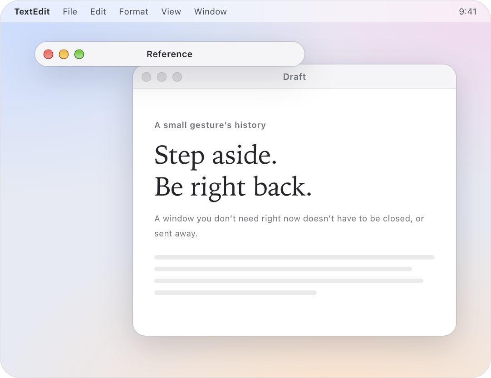
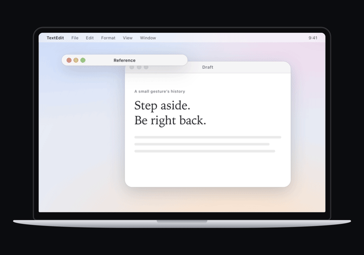

<div align="center">


# WindowShade

**Roll it up. Keep its place.**<br>
Double-click a title bar and the window rolls up into a thin bar, right where it was.<br>
Double-click again and it’s back. Rest the pointer on the bar to glance at it without unrolling.<br>
A free, open-source window utility for Mac.

[](https://github.com/surfine/WindowShade/releases/latest)
[](#download)
[](#download)
[](LICENSE)

[**Download for Mac**](https://github.com/surfine/WindowShade/releases/latest) · [**Website**](https://windowshade.aaronlau.me/en/) · [**Intro video**](https://www.bilibili.com/video/BV1K7ag6WEdH/) (Bilibili, in Chinese) · [**Window stories**](https://windowshade.aaronlau.me/en/history/) · [简体中文](README_CN.md) · [繁體中文](README_TW.md)

<picture>
  <source media="(prefers-color-scheme: dark)" srcset="assets/readme-desk-en-dark.png">
  
</picture>

<sub>The interactive illustration from the website: Reference rolls up, and the draft behind it shows through. <a href="https://windowshade.aaronlau.me/en/">Try it yourself →</a></sub>

</div>

## Three ways to move a window aside. Only one never makes you look for it.

When a window covers something, you probably close it or minimize it. Both work. Getting it back just takes a little effort.

| | Where the window goes | Getting it back |
| --- | --- | --- |
| **Close** | It’s gone | Open it again, then find your place again |
| **Minimize** | Into the Dock | Spot it in the Dock first |
| **Roll up** | A thin bar, right where it was | Double-click the bar |

Unlike minimizing, the window never leaves the desktop. Drag the bar somewhere else and the window opens there.

## Download

Get the latest DMG from [Releases](https://github.com/surfine/WindowShade/releases/latest), open it, drag `WindowShade.app` onto Applications, then open it and follow the permission prompts. (The ZIP is the same app and is what in-app updates use.) It lives in the menu bar and stays out of your Dock.

- **Needs macOS 15 or later and Apple Silicon.** There’s no Intel build.
- **1.0.17 download:** 10.65 MB ZIP; the extracted app contains 27.48 MB of files (decimal MB; filesystem allocation may differ). It now includes on-device crash reporting, hence slightly bigger.
- **Notarized by Apple.** macOS checks it on first launch, so there’s nothing to override.
- **Updating from 1.0.16 or earlier:** download this one by hand, then reopen Accessibility and Screen Recording in System Settings → Privacy & Security. From here on, updates install from the menu.
- Every release ships with a SHA-256 checksum file; for what changed in each version, see the [release notes](https://github.com/surfine/WindowShade/releases).

## What it does

**Roll up.** Double-click a title bar or press `⌃⌘C` and the window rolls up into a thin bar; double-click the bar to unroll it. The bar can keep the window’s own look, or use one consistent title bar. While a bar is in front, `⌘W`, `⌘M`, `⌘H`, `⌘Q` and `⌘N` go to the window and app behind it; `⌘Q` puts the window back down first, so any “save changes?” question is where you can see it.

**Title-bar gestures.** Put the pointer on a title bar and swipe with two fingers: push up to roll up, pull down to fill the screen between the menu bar and the Dock, push up again to put it back. Nothing happens until you let go, so pulling back halfway undoes it, and a panel styled like the system volume indicator says what letting go will do. Swipe sideways for half the screen; keep swiping the same way for two thirds, then one third, and once more moves the window to the display on that side. Turn down or up after a sideways swipe to take that corner. Spreading two fingers also fills the screen, and pinching undoes the last placement. Drag a title bar, throw it and let go, and the window glides the way you threw it — up rolls up, down fills, the sides walk the same steps, and a throw aimed at a corner takes it. With an ordinary mouse, three notches of the wheel on a title bar count as one swipe; Magic Mouse support is still being checked on real hardware. Details are in the [gesture notes](docs/gestures.md).

**Glance.** Rest the pointer on the bar and a card drops down beneath it, showing the window's content at its own size; move away and it rolls back up. Click the card to unroll the window for real; on a Force Touch trackpad, pressing firmly on the bar also glances, and letting go puts it away. The bar stays put and the card hangs just below it, so it reads as a preview, not the window itself. A glance never switches the app you’re in and never moves a window. A window that was minimized when it rolled up can’t be shown live, so you see how it looked then, and the corner says so. Details are in the [glance notes](docs/glance.md).

**Carry and pin.** Press `⌃⌘G` to carry the current window to every desktop: it stays where it is, and its bar appears in the top-right corner of your other desktops. Rest on the bar for a live picture — if the window is hidden or minimized, a labelled snapshot appears instead — and click it to go there; press `⌃⌘G` again to put it down. Press `⌃⌘P` to pin a window, so it stays uncovered while you switch to anything else; the menu bar lists every pinned window and can unpin them all at once.

**Window browsing.** Rest the pointer on an app’s icon in the Dock and every window that app has open is listed, each with a picture and a title. The panel is for looking: a window changes only when you press a button on its card; Space gives a large preview without bringing the window forward; placement shows where the window will go and moves it only when you agree, and you can undo afterwards. You can also open it from Choose window… in the menu bar, or with a hot key you set — the Dock entry is off by default. The panel is temporary: it does not replace the Dock or take over Command-Tab. Details are in the [window browsing notes](docs/window-browser.md).

**Launchpad.** Record a shortcut (for example `⌃⌘L`) to open the Home grid: every app, with the App Library on the last page. Drag an icon to a screen edge for Slide Over, with a split handle. It opens even when the notch is off. Details are in the [Launchpad notes](docs/launchpad.md).

**More layouts and actions.** Magic Tiling, the scroll strip, Picture in Picture (a window shrinks to a live picture that floats in a screen corner), `⌥`-Tab to switch by window, and Dock click-to-hide (off by default; turn it on in Settings). Settings → Shortcuts can bring Rectangle’s key set over in one click.

**The notch (off by default; turn it on in Settings).** Once on, it brings live activities, the file shelf, accessory battery notices, the volume/brightness display and “Move this app aside”, each with its own switch. For a careful action such as turning off automatic update checks, the notch opens around the system fingerprint prompt so you confirm with Touch ID; it does not unlock macOS. [Details](docs/touch-id-island.md)

**Interface language.** Settings → Advanced → Interface language: follow the system, 简体中文, 繁體中文 or English. It takes effect immediately, no restart. English covers the whole Settings window and the notch sentences; menus, Window Browser, privacy and a few more are still being translated.

**An extra: close the lid, and the desktop stays put.**



On an Apple Silicon MacBook with a hinge sensor, the screen closes but the desktop seems to stay where it was, like a page behind glass, growing darker and blurrier toward the top. Open the lid and it’s back. Three styles: gentle, standard and frosted. It’s only an extra: rolling up and pinning work without it.

## This double-click is older than your Mac

In the ’90s, most Mac users knew this trick. Then the system changed course, sent windows to the Dock, and the trick was slowly forgotten. We wrote its story as a long read you can operate — [Window stories](https://windowshade.aaronlau.me/en/history/): seven chapters, four hands-on experiments, 14 primary sources. It ends at a [working System 7.5, Mac OS 8 or Mac OS X 10.1](https://windowshade.aaronlau.me/en/history/#lab), run by [Infinite Mac](https://infinitemac.org/), where you can find the setting through the original menus yourself.

Today’s WindowShade is an independent Swift / AppKit app: the old name and the old idea, with code written from scratch. It is not an Apple product, and it uses no code from Rob Johnston, Apple, or Unsanity’s WindowShade X.

## Shortcuts

Record your own in Settings → Shortcuts, or bring Rectangle’s key set over in one click. 1.0.17 presets none of these for new setups; setups upgraded from 1.0.15 or earlier keep the combinations below. Every shortcut can be changed or turned off, and if another app already uses a combination, WindowShade tells you once.

| Shortcut (upgraded setups) | What it does |
| --- | --- |
| `⌃⌘C` | Roll up or unroll the current window |
| `⌃⌘P` | Pin or unpin the current window |
| `⌃⌘G` | Carry the current window to every desktop; press again to put it down |
| `⌃⌘1…9` | Unroll a rolled-up window, in menu order |
| `⌃⌘0` | Line up the bars, or switch to a focus layout |
| `⌃⌘←` `⌃⌘→` `⌃⌘↑` `⌃⌘↓` | Place the current window: to the sides, one size down, one size up |

Double-click a title bar to roll up; double-click the bar to unroll.

## Your windows stay on your Mac

WindowShade asks for two permissions. **Accessibility** (called Device Control and Data Access in System Settings from macOS 27): finding, moving and restoring windows. **Screen Recording**: taking the window pictures used for previews. “Screen Recording” is just the name the system gives that permission — everything is processed on your Mac and nothing is uploaded. If the app ever quits unexpectedly, your windows go back to how they were. WindowShade collects no usage data and does no analytics or reporting; checking for updates goes online. Everything it reads is listed under Privacy in Settings and on the [privacy page](https://windowshade.aaronlau.me/privacy/).

Regular windows all roll up. Stickies rolls up in its own system way; apps like Adobe’s that draw their own title bars are handled separately. Full screen, Split View, Stage Manager and multiple displays still have a few gaps — try it once with the apps you use. If something goes wrong, please [report it](https://github.com/surfine/WindowShade/issues) with your macOS version, the app, and the steps.

### Removing it completely

WindowShade changes one system setting: the Dock’s minimize effect. When it needs to, it switches it to Scale and writes down the old value first; it puts the old value back when you quit, and after an unexpected quit it does so on the next launch. Quit WindowShade from its menu before deleting it and that setting is already back. Then:

1. Drag `WindowShade.app` to the Trash. If you turned on “Open at login”, remove it in System Settings → General → Login Items.
2. Delete the files it created in your account:
   - `~/Library/Application Support/WindowShade/` (recovery records, file shelf, device key)
   - `~/Library/Logs/WindowShade/` (activity log)
   - `~/Library/Caches/com.windowshade.prototype/`, `~/Library/HTTPStorages/com.windowshade.prototype/`
   - `~/Library/Preferences/com.windowshade.prototype.plist`, `~/Library/Preferences/com.windowshade.prototype.update-guard.plist`
3. If you used face unlock or the iPhone remote, search Keychain Access for `WindowShade` and delete the `WindowShade.FaceScan.templates` and `WindowShade.Remote.peers` items.
4. To clear the permissions too, remove WindowShade from Accessibility (Device Control and Data Access from macOS 27) and Screen Recording in System Settings → Privacy & Security.

## In development

The current download is **1.0.17**. Everything described above is in it; this version also adds a three-step welcome, a “What WindowShade reads” privacy page, diagnostics export and settings export/import. [Release notes](docs/releases/v1.0.17.md)

What comes next is **WindowShade 2**: your Mac’s windows taking direction, and answering to the devices at hand. Part of it is already written and sits behind a preview switch in 1.0.17 — not shown in Settings and not running:

- **Conductor mode and coding sessions** — the state and approvals of several coding sessions in one place.
- **Remote control** — drive this Mac from an iPhone or similar device, including mute control.
- **CarPlay reception** — put the iPhone’s picture on the whole screen.
- **Mouse and trackpad** — finer settings such as smooth scrolling, side buttons and three- or four-finger taps.

A few more are still experimental or device-limited: face scanning, presence locking, remote control and CarPlay. None of this claims macOS face unlock or complete CarPlay reception.

## Build and contribute

Requires macOS 15+, Xcode command line tools with the Metal compiler, and an Apple Development signing certificate.

```sh
git clone https://github.com/surfine/WindowShade.git
cd WindowShade/prototype
./build.sh --check   # Swift type checking and Metal compilation
./build.sh           # build and sign with your configured identity
open WindowShade.app
```

Set `WINDOWSHADE_CODESIGN_IDENTITY` or use an untracked `prototype/local-codesign.env`. See [DEVELOPMENT.md](DEVELOPMENT.md) for signing, isolated builds, and release instructions; interface and website copy follows the [copy guide](docs/copy-guide.md).

| In the repository | Purpose |
| --- | --- |
| [`prototype/`](prototype/) | Native app: window policies, capture, overlays, effects, and recovery |
| [`tests/`](tests/) | State, recovery, frame, Metal, and paper-component checks |
| [`site/`](site/) | Bilingual website and window stories, hosted on Cloudflare Pages |
| [`docs/performance.md`](docs/performance.md) | Measurements and approaches that did or did not work |
| [`docs/releases/`](docs/releases/) | Preserved release notes |
| [`WindowShade.md`](WindowShade.md) | Original design rationale and research notes |

For changes to window behavior, include the affected window type, what happened before and after, and the checks you ran.

## Credits and license

[MIT](LICENSE) for this project's code. Historical names and software belong to their respective authors. The window stories credit [Infinite Mac](https://infinitemac.org/), Marcin Wichary's [Frame of preference](https://aresluna.org/frame-of-preference/), and [AI System 6](https://github.com/surfine/AI-System-6) for its era-rendering reference. Bundled font and reference-asset licenses are retained in [`site/public/fonts/`](site/public/fonts/).
