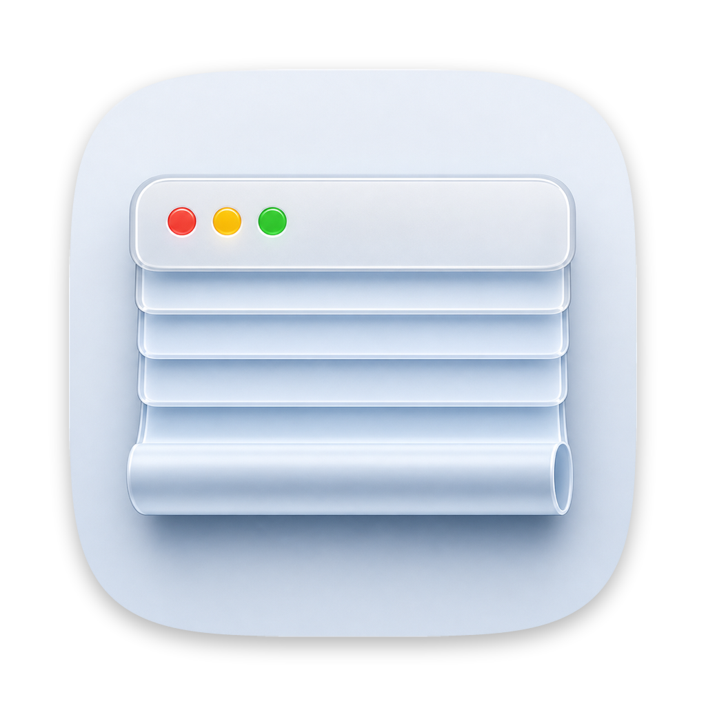
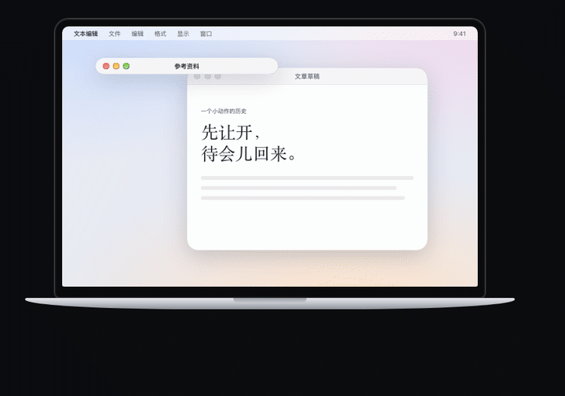

<div align="center">



# WindowShade

**收起窗口，留下位置。**<br>
双击标题栏，窗口收成一条卷帘条，停在原处；再双击，它原样回来。<br>
指针停在卷帘条上，不用展开就能看一眼。<br>
免费开源的 Mac 窗口小工具。

[](https://github.com/surfine/WindowShade/releases/latest)
[](#下载)
[](#下载)
[](LICENSE)

[**下载 Mac 版**](https://github.com/surfine/WindowShade/releases/latest) · [**官网**](https://windowshade.aaronlau.me/) · [**介绍视频**](https://www.bilibili.com/video/BV1K7ag6WEdH/) · [**窗口往事**](https://windowshade.aaronlau.me/history/) · [繁體中文](README_TW.md) · [English](README.md)

<picture>
  <source media="(prefers-color-scheme: dark)" srcset="assets/readme-desk-dark.png">
  
</picture>

<sub>官网首页的互动示意：「参考资料」收起后，后面的草稿露了出来。<a href="https://windowshade.aaronlau.me/">去官网亲手试一试 →</a></sub>

</div>

## 让开的办法有三种，只有一种不用回头找

窗口挡住了后面的东西，你多半会关掉它，或者最小化。两种都管用，只是回来的时候要费点工夫。

| | 窗口去了哪儿 | 回来的时候 |
| --- | --- | --- |
| **关掉** | 没了 | 重新打开，再翻回刚才那一页 |
| **最小化** | 进了 Dock | 先在 Dock 里认出它 |
| **收起** | 收成一条卷帘条，还在原处 | 双击卷帘条，它就回来 |

收起和最小化不一样：窗口不离开这张桌面。把卷帘条拖到别处，窗口就在新位置展开。

## 下载

到 [Releases](https://github.com/surfine/WindowShade/releases/latest) 下载最新的 ZIP，解压，把 `WindowShade.app` 拖进“应用程序”打开，按提示给权限。它住在菜单栏里，不占 Dock 位置。

- **要 macOS 15 以上、Apple Silicon。** 没有 Intel 版。
- **1.0.17 下载包：** ZIP 10.65 MB，解压后的应用文件合计 27.48 MB（十进制；文件系统实际占用可能不同）。包里多了只存在本机的崩溃报告，所以比上一版大一点。
- **已通过 Apple 公证。** 第一次打开时系统会自己检查，不用再手动放行。
- **从 1.0.16 及以前升级：** 这一版要手动下载一次，装好后在“系统设置 → 隐私与安全性”里重新打开辅助功能和屏幕录制。之后就能在菜单里更新。
- **用 Homebrew：** `brew install --cask surfine/tap/windowshade`。
- 每次发布都附 SHA-256 校验文件。每个版本改了什么，见 [更新记录](https://github.com/surfine/WindowShade/releases)。

## 它能做什么

**收起窗口。** 双击标题栏或按 `⌃⌘C`，窗口收成一条卷帘条；双击卷帘条展开。收起后的样子可以选“跟原来一样”，也可以选“统一标题栏”。卷帘条在最前面时按 `⌘W`、`⌘M`、`⌘H`、`⌘Q`、`⌘N`，作用在它背后的窗口和 App 上；按 `⌘Q` 会先把窗口放下来，要问“是否保存”时你看得见。

**在标题栏上滑一下。** 把指针放在标题栏上，用两根手指滑：往上推，它收成一条卷帘条；往下拉，它铺满菜单栏和 Dock 之间的屏幕；再往上推回到原来的大小。松手才算数，滑到一半往回拉，就当没发生过；滑动时旁边有一块和系统音量提示同样样式的小浮窗，写着松手会做什么。左右滑占半屏；朝同一边再滑，变成三分之二、三分之一；那边还有一块屏幕的话，再滑就移过去。左右滑到位后接着往下或往上拐，窗口占那个角。两指张开也是铺满，捏合撤销上次排布。拖着标题栏快速甩出去再松手，窗口带着这股劲滑到甩的那一边：往上收起，往下铺满，左右走同一架梯子，明显朝着角落甩就占那一角。普通鼠标在标题栏上滚三格算一次；Magic Mouse 的支持还在真机上验证。细节见 [标题栏手势说明](docs/gestures.md)。

**看一眼。** 指针在卷帘条上停一下，卷帘条下面就挂出一张卡片，按原来的大小显示窗口里的内容；移开，它自己收回去。单击卡片才真正展开。卷帘条留在原处，卡片和它隔着一道缝，一看就知道这是预览，不是窗口本身。它不会切换当前的 App，也不会动任何窗口。收起时被最小化的窗口拿不到实时画面，这时看到的是收起时的画面，角落会写明。细节见 [看一眼说明](docs/glance.md)。

**带到每张桌面、置顶。** 按 `⌃⌘G` 把当前窗口带到每张桌面：窗口留在原处，别的桌面右上角出现它的卷帘条；停在上面看一眼（窗口被隐藏或最小化时改显示带提示的截图），单击画面就回到它，再按一次放下。按 `⌃⌘P` 把那扇窗口置顶，你切到别的窗口，它也不会被盖住；菜单栏里能看到所有置顶的窗口，也能一次全部取消。

**窗口浏览。** 把指针停在 Dock 里的应用图标上，这个应用开着的窗口会一起列出来，每扇都带画面和标题。面板只用来看：按下卡片上的按钮，才会动那扇窗口；选中一扇按空格打开大图预览，窗口不会被切到前面；左右、四角、居中、填满或移到别的屏幕，都先画出窗口要去的位置，你同意了才移动，移好了还能撤销。也可以从菜单栏的“选择窗口…”打开，或者按你自己设的快捷键——Dock 入口默认关闭。面板是临时的：不替换系统 Dock，也不接管 Command-Tab。细节见 [窗口浏览说明](docs/window-browser.md)。

**启动台。** 录一个快捷键（例如 `⌃⌘L`）打开主屏幕，列出所有 App，末页是 App 资料库；把图标拖到屏幕边就侧拉，带分屏把手。刘海关着时也能打开。细节见 [启动台说明](docs/launchpad.md)。

**更多排布与动作。** 魔法平铺、卷轴、画中画（窗口缩成一张实时画面，浮在屏幕角落）、`⌥`+Tab 按窗口切换，以及点 Dock 图标让开后隐藏（默认关，在设置里打开）。设置 → 快捷键里能一键换上 Rectangle 那一套。

**刘海（默认关，在设置里打开）。** 打开后，刘海里有实时活动、文件架、配件电量提醒、音量亮度提示和“让开这个 App”，这几项也各自在设置里开关。关掉自动检查更新这类要小心的操作，刘海会展开系统的指纹提示，用 Touch ID 确认；它不解锁 macOS。[说明](docs/touch-id-island.md)

**界面语言。** 设置 → 高级 → 界面语言可选跟随系统、简体中文、繁體中文、English，切换立即生效，不用重启。英文覆盖整个设置窗口和刘海上的短句；菜单、窗口浏览、隐私等还在逐批补齐。

**彩蛋：合上盖子，桌面留在原处。**



在带铰链传感器的 Apple Silicon MacBook 上，合盖时，屏幕合下来，桌面却像一页纸留在原处，越往上越暗、越模糊；开盖就复原。质感有轻柔、标准、磨砂三种。它只是个彩蛋，收起窗口和置顶都用不着它。

## 这个双击，比你的 Mac 还老

三十年前的 Mac 用户，大多会这一招。后来系统换了思路，把窗口送进 Dock，它就慢慢被人忘了。我们把这段往事写成了一篇可以动手的长文 **[窗口往事](https://windowshade.aaronlau.me/history/)**：七章，四个动手实验，14 条原始史料。结尾还能 [启动一台旧 Mac](https://windowshade.aaronlau.me/history/#lab)（System 7.5、Mac OS 8、Mac OS X 10.1，由 [Infinite Mac](https://infinitemac.org/) 运行），沿着当年的菜单自己找到这个设置。

今天的 WindowShade 是独立的 Swift / AppKit 实现，借用了老名字和老想法，代码从头写起。它不是 Apple 的产品，也没有用 Rob Johnston、Apple 或 Unsanity WindowShade X 的代码。

## 快捷键

自己在“设置 → 快捷键”里录，也可以一键换上 Rectangle 那一套。1.0.17 新装的一项都不预设；从 1.0.15 及以前升级上来的，保留下面这几组。快捷键都能改键或关掉；某个组合被别的应用占用时，会提示你一次。

| 快捷键（升级上来的） | 做什么 |
| --- | --- |
| `⌃⌘C` | 收起或展开当前窗口 |
| `⌃⌘P` | 置顶或取消置顶当前窗口 |
| `⌃⌘G` | 把当前窗口带到每张桌面，再按一次放下 |
| `⌃⌘1…9` | 按菜单里的顺序展开收起的窗口 |
| `⌃⌘0` | 排好卷帘条，或进入专注布局 |
| `⌃⌘←` `⌃⌘→` `⌃⌘↑` `⌃⌘↓` | 排布当前窗口：左右排布，变小一级，变大一级 |

双击标题栏收起，双击卷帘条展开。

## 你的窗口，只留在你的 Mac 上

WindowShade 要两项权限。**辅助功能**（macOS 27 起在系统设置里叫“设备控制和数据访问”）：找到、移动、恢复窗口。**屏幕录制**：拍下窗口画面做预览。“屏幕录制”只是系统给这个权限起的名字，画面只在你的电脑上处理，不会传到别处。应用万一意外退出，窗口也会自动恢复原样。WindowShade 不收集使用数据，也不做任何统计或上报；检查更新时会联网。它读到的每一样都列在设置里的“隐私”一栏和[官网隐私页](https://windowshade.aaronlau.me/privacy/)。

普通窗口都能收起。便笺用系统自己的收起方式；Adobe 这类自己画标题栏的应用会单独处理。全屏、分屏、台前调度和多显示器还有少数情况没覆盖，建议先在你常用的应用里试一次。碰到问题欢迎[反馈](https://github.com/surfine/WindowShade/issues)，写上 macOS 版本、应用名和操作步骤。

### 怎么彻底删掉

WindowShade 只改过一项系统设置：程序坞的「最小化效果」。用到时改成「缩放」，改之前记下原值；正常退出时还原，意外退出后下次启动先还原。删掉之前先在菜单里退出 WindowShade，这一项就已经回到原样。其余要删的：

1. 把 `WindowShade.app` 拖到废纸篓；如果开过「登录时自动启动」，到“系统设置 → 通用 → 登录项”里把它移掉。
2. 删掉它在你账户里建的文件：
   - `~/Library/Application Support/WindowShade/`（恢复记录、文件架、设备密钥）
   - `~/Library/Logs/WindowShade/`（运行记录）
   - `~/Library/Caches/com.windowshade.prototype/`、`~/Library/HTTPStorages/com.windowshade.prototype/`
   - `~/Library/Preferences/com.windowshade.prototype.plist`、`~/Library/Preferences/com.windowshade.prototype.update-guard.plist`
3. 如果用过刷脸解锁或 iPhone 遥控器，在“钥匙串访问”里搜 `WindowShade`，删掉 `WindowShade.FaceScan.templates` 和 `WindowShade.Remote.peers` 两类条目。
4. 想连授权一起清掉：“系统设置 → 隐私与安全性”的“辅助功能”（macOS 27 起叫“设备控制和数据访问”）和“屏幕录制”里把 WindowShade 移掉。

## 开发中

当前下载版是 **1.0.17**。上面写的都在里面；这一版新增三步欢迎窗口、“WindowShade 读到的”隐私页、导出诊断信息和导出／导入设置。[发布说明](docs/releases/v1.0.17.md)

接下来的方向是 **WindowShade 2**：让 Mac 的窗口听你指挥，也能被手边的设备遥控。其中一部分已经写进代码，1.0.17 里藏在预览开关后面——设置里看不到，也不会运行：

- **指挥模式、编程会话** —— 把多个编程会话的状态和审批集中到一处。
- **遥控器** —— 用 iPhone 等设备控制这台 Mac，含静音操作。
- **CarPlay 接收** —— 把 iPhone 的画面放到整块屏幕。
- **鼠标与触控板** —— 平滑滚动、侧键和三指／四指轻点等更细的设置。

另有几项仍在实验、有设备限制：刷脸、离开就锁、遥控和 CarPlay。现在不能据此声称支持系统刷脸解锁或完整 CarPlay 接收。

## 构建与参与

需要 macOS 15+、包含 Metal 编译器的 Xcode command line tools，以及 Apple Development 签名证书。

```sh
git clone https://github.com/surfine/WindowShade.git
cd WindowShade/prototype
./build.sh --check   # Swift 类型检查与 Metal 编译
./build.sh           # 使用本机配置的身份构建、签名
open WindowShade.app
```

通过 `WINDOWSHADE_CODESIGN_IDENTITY` 或未跟踪的 `prototype/local-codesign.env` 配置签名。签名、隔离构建与发布步骤见 [DEVELOPMENT.md](DEVELOPMENT.md)；界面和官网文案按 [文案规则](docs/copy-guide.md) 写。

| 仓库入口 | 内容 |
| --- | --- |
| [`prototype/`](prototype/) | 原生应用：窗口策略、捕获、覆盖层、效果与恢复 |
| [`tests/`](tests/) | 状态、恢复、帧、Metal 与纸面组件检查 |
| [`site/`](site/) | 部署在 Cloudflare Pages 的中英文官网与窗口往事 |
| [`docs/performance.md`](docs/performance.md) | 实测结果，以及尝试过但没有奏效的办法 |
| [`docs/releases/`](docs/releases/) | 历次发布说明 |
| [`WindowShade.md`](WindowShade.md) | 最初的设计理由与研究笔记 |

修改窗口行为时，请写明窗口类型、修改前后的表现，以及做过的检查。完整规则见 [CONTRIBUTING.md](CONTRIBUTING.md)；用法问题和想法请到 [Discussions](https://github.com/surfine/WindowShade/discussions)。

觉得好用的话，在 GitHub 点个 ⭐，能让更多人找到它。

## 致谢与许可

本项目代码采用 [MIT](LICENSE)。历史软件和名称属于各自作者。窗口往事感谢 [Infinite Mac](https://infinitemac.org/)、Marcin Wichary 的 [《偏好之形》](https://aresluna.org/frame-of-preference/)，以及提供时代外观实现参考的 [AI System 6](https://github.com/surfine/AI-System-6)。随站点分发的字体和参考资源许可保留在 [`site/public/fonts/`](site/public/fonts/)。
