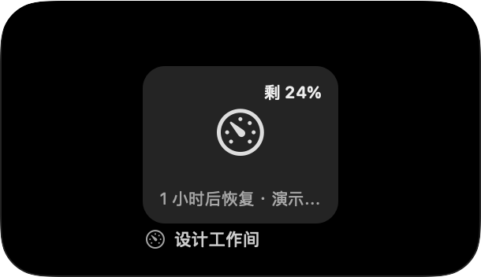
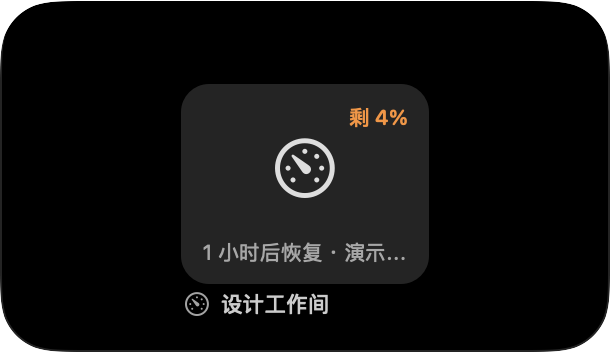
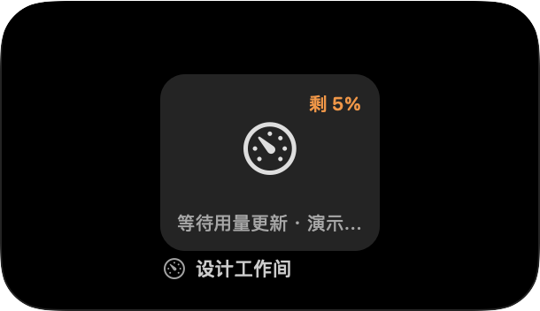
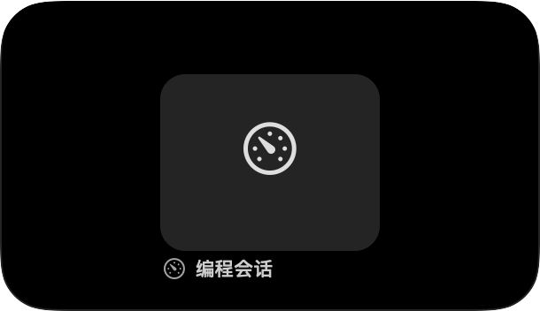

# 用量 · 画面稿

2026-10-11设计接管静态稿。用量长在已有编程会话里。紧凑与展开都写“剩”，不把同一份账户额度算成每扇会话的额度。会话模型、思考档位和上下文留在各自的会话信息里；账户限制必须带来源提供的窗口身份，不从套餐名字猜五小时或无限。

先修已有格子：剩余数字在右上角，低额沿现有琥珀色；项目名仍在格子下，恢复时间与模型仍在原副句。没有用量事实时回到“在跑”，没有0、100%或无限符号；人在等你时先显示“等你”。不靠单独一圈环替代数字和口径，不增加主宿主。

来源给出的恢复时刻到了，只写“等待用量更新”，保留最后读到的剩余；新来源读数到来后才更新。不会暂停远端周期，不用本机时钟给额度充满，也不把“马上恢复”写成确定承诺。比“预计已恢复，等待更新”更短的一句，避免小格中后半句被截掉。

这是一块持续活动，不是账户账单页。五小时、一周等细项在展开详情里分别带标签与恢复时间；来源没给的栏不画。现有格子副句长模型会省略，完整内容在提示；账户详情与上下文分离的[展开候选](用量详情.md)已成形，尚未接入产品，不把本批一格样件冒充整页完成。

上层放行/手势/主动打开沿原仲裁，量更新保同一格身份，低额提醒每个实际窗口一次。原菜单与Return为不用手的入口，不新增“暂停额度”；减少动态/透明与增强对比沿既有令牌，VoiceOver念清“剩”的数字。来源、模型控制、刷新和读屏执行仍需各自准入。

20张真实生产视图静帧，全部由自己生成的额度事件驱动纯Core投影，没有真实账户、网络、模型任务或控制器。普通、低额与同格5→4、0、未知、到期、一周更紧、长模型、等你、共享各有浅深父外观。不是账户详情页；模型与恢复副句的一行省略仍是实际限制，[下一张候选](用量详情.md)把账户窗口分开，再摆当前会话的信息。读屏执行、紧凑新帧和真正更新事件链仍未验。

本批修前普通格漏数字、低额单独漏耳字、过期写“马上恢复”；修后确实显示剩余、未知不补数字、等待更新不把额度充满。超出整数表示范围的恢复时间只丢该时间字段，额度保留，避免窗口身份转换崩溃。共享候选直接用实际sessionRedacted值变换，不触动系统共享开关。
