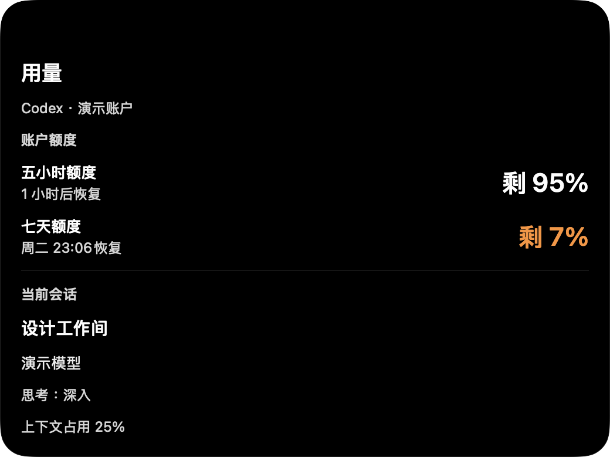
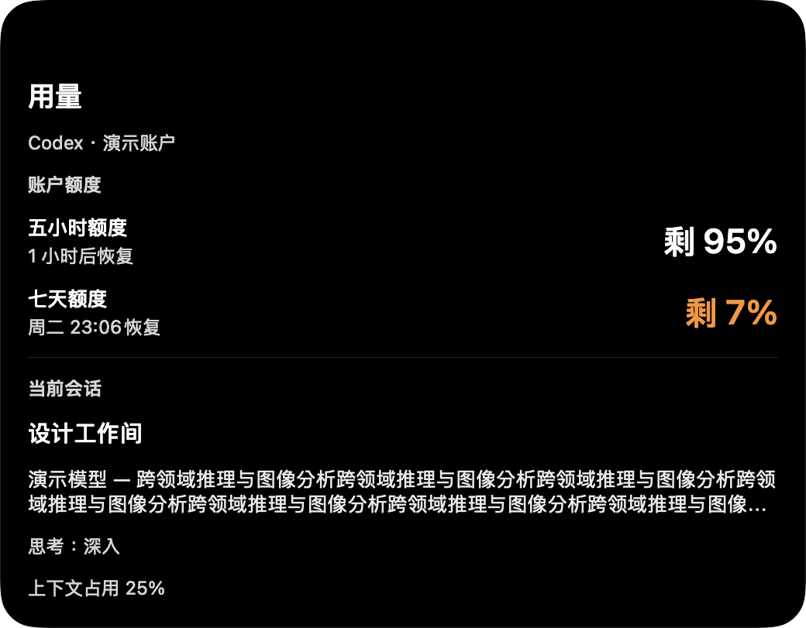
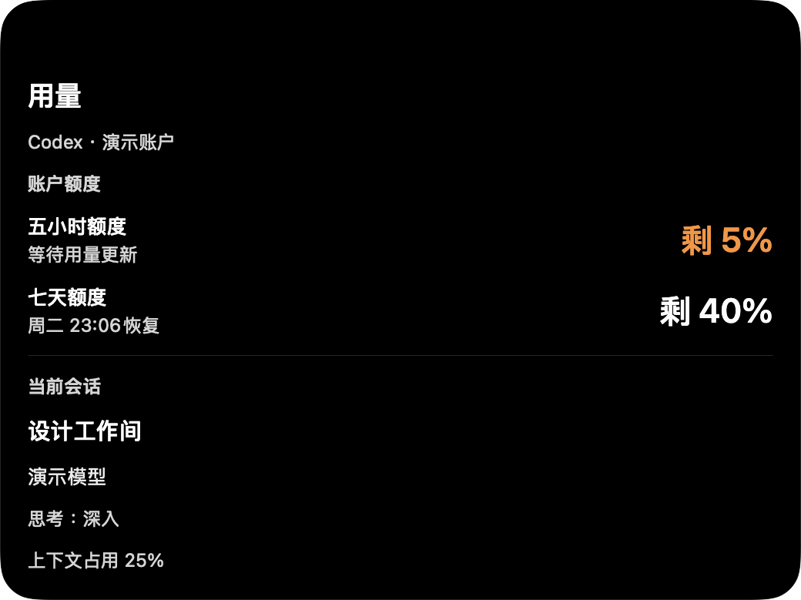
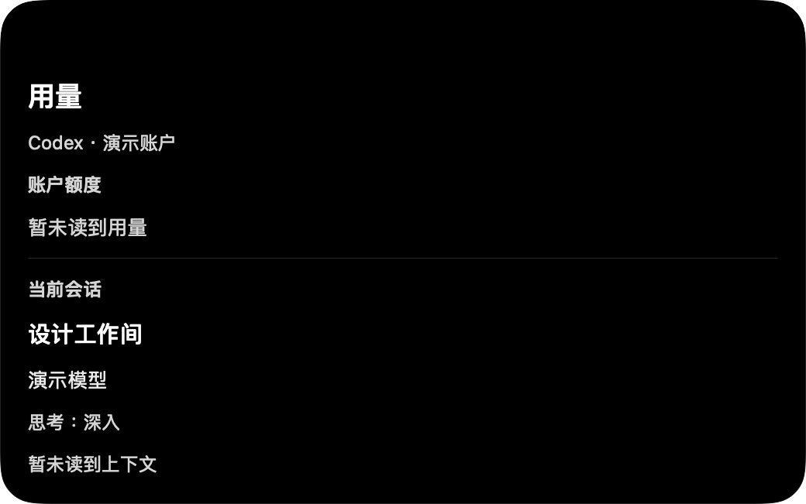
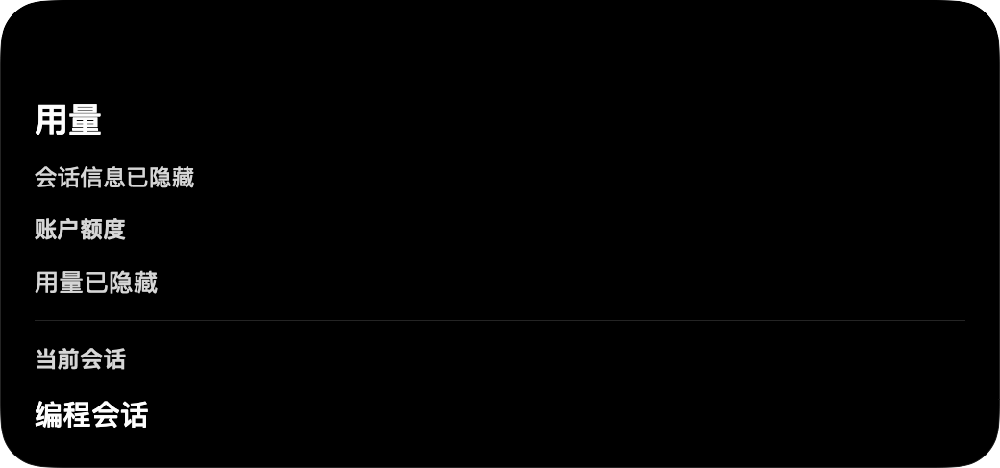

# 用量详情 · 候选画面

账户额度与当前会话分开读。上半部按来源给出的窗口逐项写名字、剩余和恢复时间；五小时与七天各自一项，不相加，也不把更紧的一项冒充全部额度。来源没给窗口时长，就写“账户额度”。恢复时刻已过而新读数未到，只写“等待用量更新”。

下半部是当前会话：项目、模型、思考档位、上下文。上下文写“占用”，和账户额度的“剩”区分。没有读数写“暂未读到”；共享候选隐藏账户数字和会话细节。模型名最多两行，末尾省略，完整名称保留在提示中。

沿既有会话宿主的520宽、纯黑底、24底角与原字体层级。额度数字用22号等宽数字，窗口名字与恢复时间落在左侧；一条细线分开账户与会话，不靠多层卡片加重小空间。

这是第二十一批设计候选，尚未接入产品。16张图来自自己的隐藏原生窗口、实际AppKit布局与纯Core解析的合成读数。上下文也是合成值，不表示现有数据通道已经提供该事实。没有真实账户、网络、模型控制、返回动作或系统输入；可见动势、读屏执行和硬件验收未做。

普通、未知、只有上下文、到期、长模型、未知窗口时长、零与共享各有浅深父外观。浅深父外观都由同一纯黑宿主承载。普通NSTextField两行换行曾默默裁掉模型尾部；候选改用实际TextKit两行末尾省略，保留原字形和完整提示。原生缓存图只证明这组静态画面，不能证明产品已出现这页或交互已经工作。
