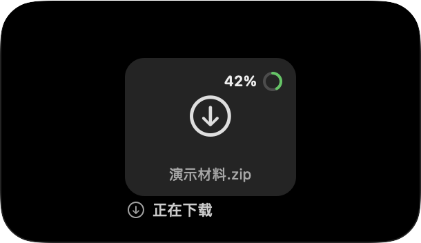
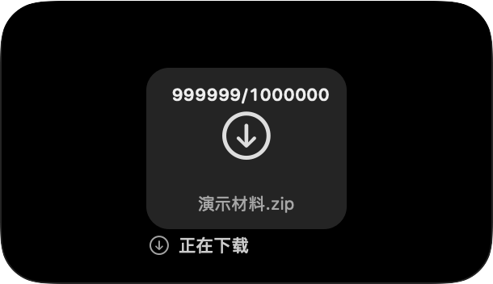
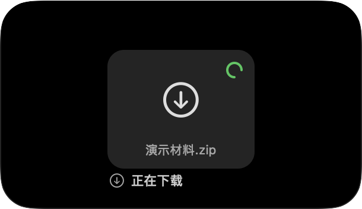
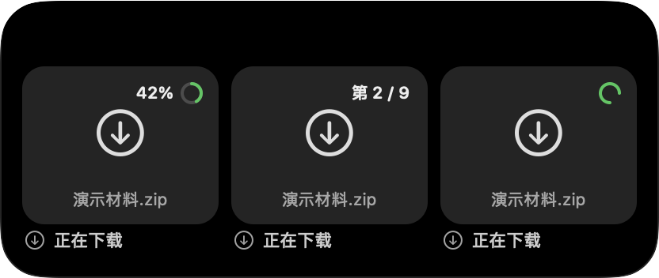

# 进度 · 画面稿

2026-10-11，设计接管静态稿。沿「一颗岛」与共同一排，形状、圆角、间距和弹簧沿现有令牌；不新增来源、不增加呈现种类。这张稿只决定读到真实进度后怎样画。

一眼先读正在做什么，再读现在到哪，文件名留在格子里。百分比用右上角的小环和准确数字；项数只写数；确认正在做但总量未知时只画不确定弧；没有事实时空着。左耳与右耳是同一件事，展开后位置关系继续沿现有稿。

100% 只表示量到终点，来源确认完成后才写完成。取消安静收回；来源过期保留最后读数但淡下去，读屏补“可能已停”。暂停由来源提供状态词，不从不动的数字猜测；读不到暂停事实就不画暂停按钮。

项数先写“第 2 / 9”。原说法放不下时沿现有紧凑短写“999999/1000000”，仍用原字号、完整数字，不编百分比、不用近似百万数。超出短写所能容纳的极端数字尚待设计，不把省略的总数算通过。

已发现原版在 999999 / 1000000 时截掉总数：[原始画面](progress-2026-10-11/before-huge-count.png)。真实AppKit全写宽116.32点，原可用104点；短写97.88点，修后完整可读。普通项数、百分比、环和布局保持原尺寸。26张当前原生静帧、30格及518输入由消费者核对；正式优化结果将绑定在证据页。

长文件名只占原来一行，完整名字留在提示，读屏与百分比/项数独立。最多三条沿协调器顺序，无第二宿主；上面的放行/手势/主动展开占住时按原规则让位，回来读现在的事实。

减少动态效果不转弧、不做数值位移，用静态弧及原内容淡化令牌；减少透明度保持黑底，增强对比度沿既有边线；VoiceOver逐项念动作、完整文件名和量。菜单/Return沿原打开动作，暂停/取消仅在来源有可靠控制时出现。这里是设计约定，静态样件不等于这些执行路径已验。

画面来自真实生产视图与自造值，不是 Finder、浏览器或云盘现场。正在做的标题、文件名、暂停与结束事实由样件显式给定；暂停样件展示已有标记，结束样件是保留最后读数的值，不冒充现有 DownloadCard.finished 的实际提醒（该提醒另用“下载好了”、对勾和无量）。紧凑两耳沿“一颗岛”稿，本批未取紧凑状态新样件。长文件名读屏目前会沿既有句长截断，完整名字可在提示里读；完整读屏与短写仍放不下的极端总数属于待补，不能算通过。旋转、淡化、仲裁与系统来源执行均未验。
