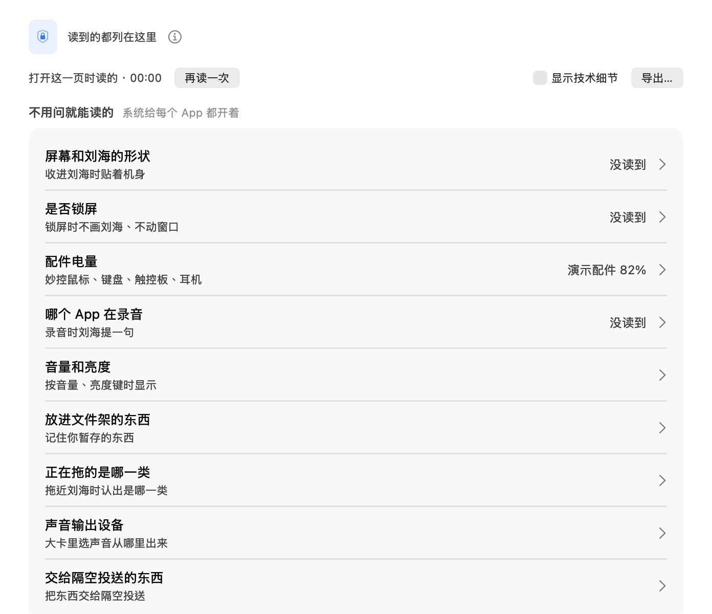
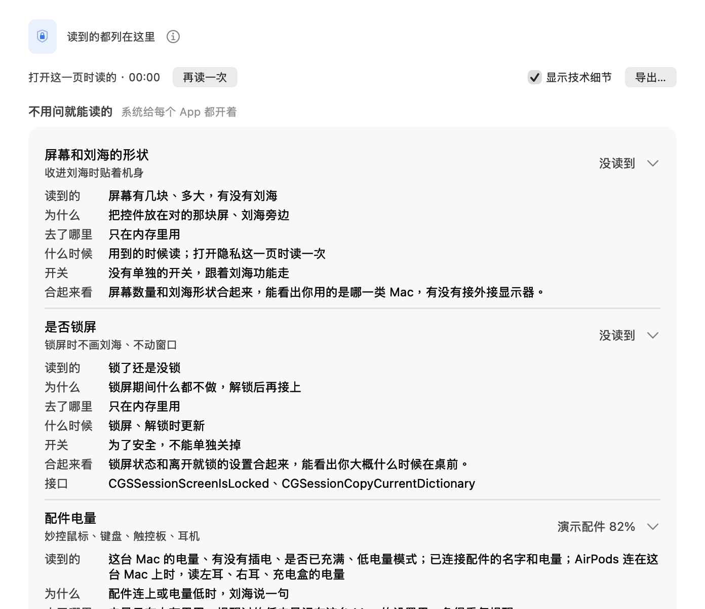
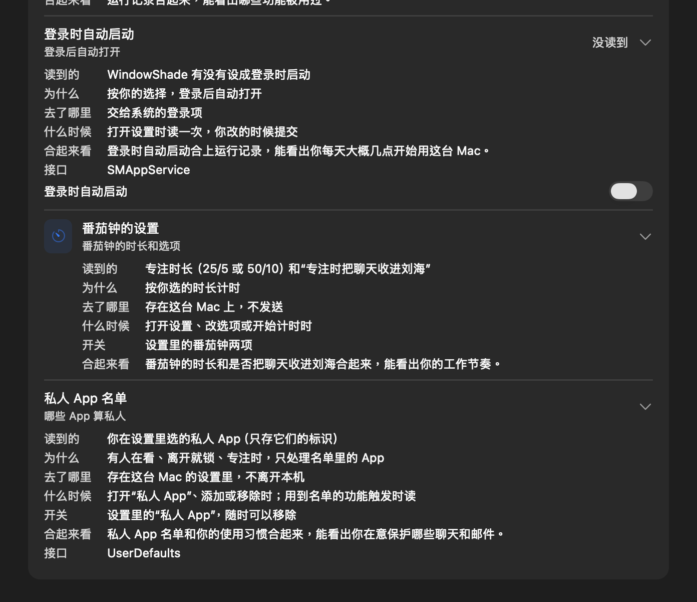

# 隐私内容列：静态组合候选

实际页头、卡片与隐私行组成640点内容列，浅深外观、折叠/展开、页顶/中/底共12帧。41默认登记行与4组的顺序、正文容纳和9个展开开关位置检查通过。所有值/权限/开关是合成状态，来源读取和动作均为0。

这是自有隐藏原生宿主中的组合候选，没有实例化生产Page；卡片/说明宿主为独立复现，不包含Page附加的私人窗口部分。权限均合成未授权，Mock按钮用于宽度压力，不能证明实际Page的授权路由政策。开关只指向自有Mock，未点击；整页绑定、真实读取、导出、读屏与硬件未验。

实际图发现番茄钟一行由中文关键词映射带入图标，其余40行没有图标，导致这一行的说明列额外缩进38点；不把这一差异算设计通过，下一批按原隐私稿统一。原生consumer0仅证明登记顺序/几何/Mock/滚动，不证明整页产品验收。

[证据与当前限制](../design-review/2026-10-11-privacy-composition-and-motion-baseline/README.md)。动效基线也在同批封存：反向初速度方向失败，尚未修正。
