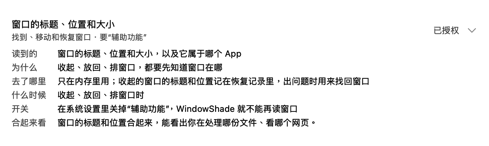
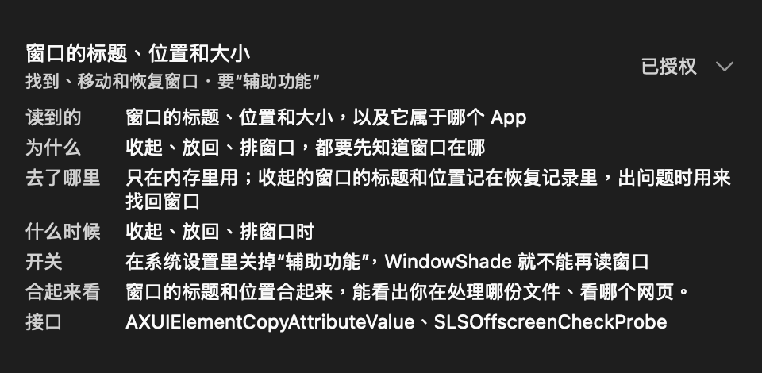
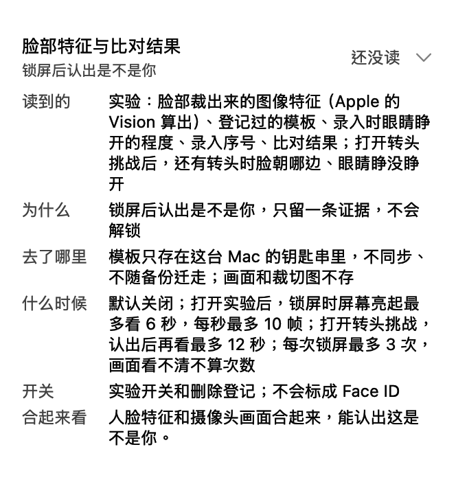

# 隐私展开 · 画面稿

已按[原隐私稿](WindowShade%20读到的.html)把标签和正文分列，接回真实PrivacyRowView。标签用次要颜色，正文用正常文字颜色；字号跟随系统正文减一档，默认12号。标签列为实际字号的4.4倍，列间10、行间4，每个详情子行受当前详情宽度约束。

“读到的、为什么、去了哪里、什么时候、开关、合起来看”在左侧。可见标签缩短，完整问题留在提示；正文登记原文与接口字串不删、不改。长说明自己换行，完整文字所需高度逐项测量，不把缩字或截正文当作排版完成。

第二十四批48张真实Row静态组合已复核。完整提示、只读可选、合成授权/未读/计划语义与长值82%保持；登记、来源、开关、授权、导出和读取时机不改。图片由自己的隐藏原生窗口与合成值产生，没有构造会读取系统的Page或owner。实验行只是长说明样件，不表示默认页出现或事实已资格化。

这个结果只覆盖实际产品行的静态布局，整页和真实数据读取尚未验收。动态大字、键盘/读屏、颜色辅助模式、性能、隐私网络/磁盘、可见合成和硬件仍待。

此前[第二十三批候选](../design-review/2026-10-11-privacy-columns/README.md)保留：36张独立AppKit候选按三条登记文案、普通/技术、三种宽度和浅深外观构造，尚未接产品时先确认了两列与12号正文。技术接口从登记表的实际读取点按行汇总、去重排序。首版长标签留下孤字，短可见标签后仍留完整提示；首次消费者误把只读当成不可选字，保错误并纠正，没有增加不需要的禁选行为。
