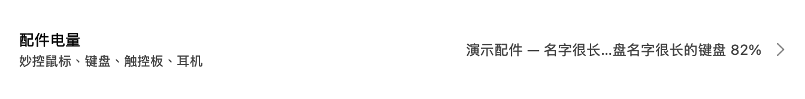
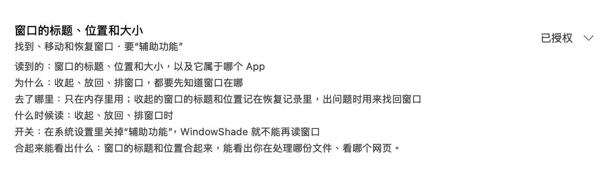
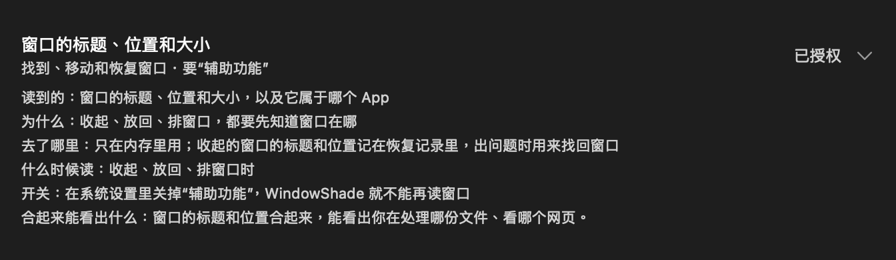
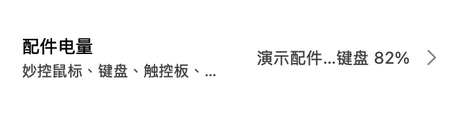

# 隐私行 · 阅读布局

沿[原隐私稿](WindowShade%20读到的.html)：每行先读名字和原因，右侧是当前值；展开后读“读到的、为什么、去了哪里”，再读时机、开关与组合起来的含义。不会为填满页面编出设备值或授权状态，“没读到”和实验功能的“还没读”分别保留。

长设备名不能撑宽页面。右侧值最多占行宽四成，中间省略长名字、留住末尾数值，左侧名称和原因也限定在各自列内；完整内容留在提示里。展开说明照原字号换行，技术接口只在“显示技术细节”后出现。本次不改变来源、开关、授权和导出路径，也不补任何联网承诺。

第二十二批只构造真实PrivacyRowView，使用登记表与合成快照，未构造会主动读系统的隐私页。640是既有设置内容上限，448与300是压力宽度；这些图片不表示新增窗口尺寸。授权拒绝仅显示文字，没有真实授权目标；计划实验只是行样件，不代表默认页显示它。整页顶栏、卡片容器、滚动、实时值读取、开关、导出、读屏、网络/磁盘和硬件实测未验。

展开说明的标签/正文层次已按[两列画面稿](隐私展开.md)接回真实Row，默认12号正文；本页第二十二批原图保留作列预算与长值的历史证据。整页与来源状态不晋级。
