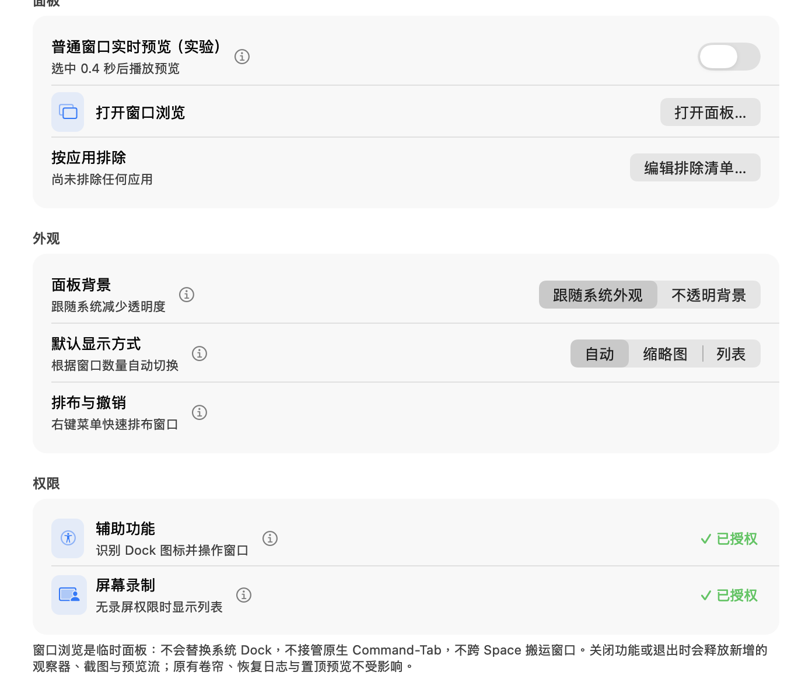
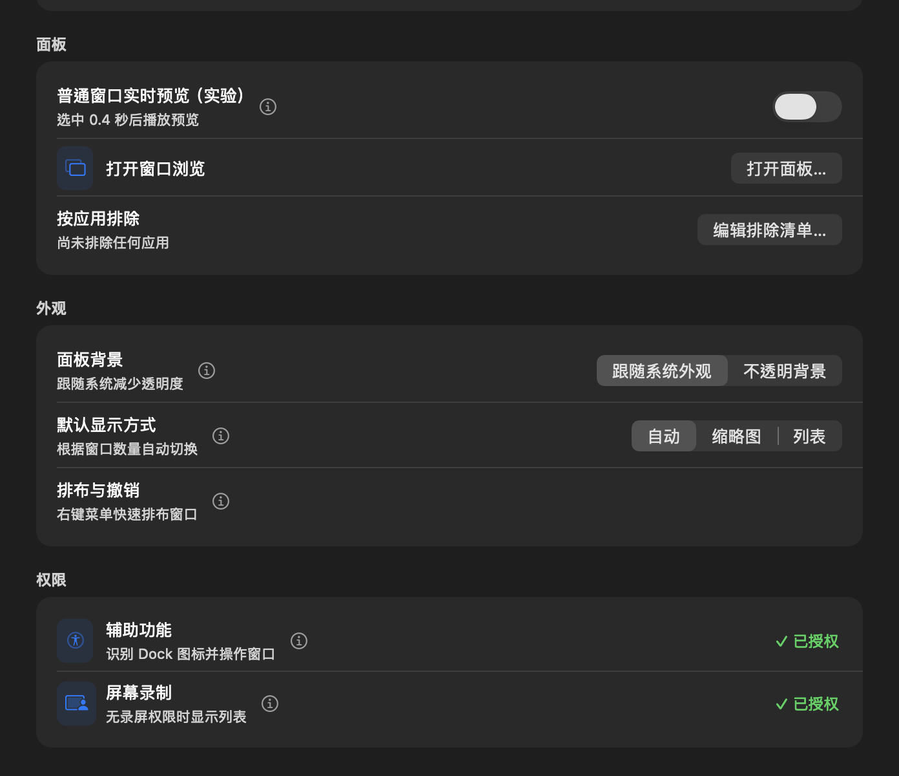

删去窗口浏览设置页尾与实际行为相矛盾的承诺。同一页可选择⌘Tab替换系统App切换，原页尾却说“不接管原生Command-Tab”；整段还混入观察器、截图流和恢复日志。对应行的短说明及详情按钮保留，完整详情仍明确说明⌘Tab的作用。

本批沿用现有系统分组表单，只删错误说明，不改开关、偏好、窗口浏览或切换逻辑。原生页面为实际AppDelegate.makeWindowBrowserSettingsPage，640点内容列、28点两侧宿主间距、22点上下间距；696×600详情视口按生产DuoSettingsWindow.select的约束挂载，透明滚动区叠在系统窗口背景色上。未构造完整设置窗口，侧栏、工具栏和其它页面不在本批验收内。

浅深外观、off/command两种合成选择、页顶/页底共8帧。实际分段控件选中0或2，标题、权限行和详情提示仍完整；页面高度从1090降至1056，宿主1134降至1100。主模型看过浅色修前页尾、深色修前页顶及深色修后页尾。

样件不运行App启动入口、运行时、输入监听或真实窗口动作。只读AXIsProcessTrusted/CGPreflightScreenCaptureAccess权限状态，不申请权限；NSArgumentDomain临时合成触发方式并恢复，不调用按钮或写持久偏好。alpha0、不显示、不激活、实际离屏几何受检。未验权限授权流程、⌘Tab真实接管、Dock行为、滚动交互、动态材质或签名App执行期。

独立消费者读取生产页真实标签、选中项、完整tooltip、PNG和518项原生来源SHA。首次消费者把“触发”原生标签x=-2判成越界：实际它在28点宿主边距内，PNG可见；原检查和失败回执保留，修为实际696点视口包含判据，产品未为QA改尺寸。修前来源已冻结并保留原Preferences/入口字节，不能用后来源码冒充修前。

本批是小范围设计与文案修正，由主模型直接完成，未另派工人。全蓝图目标仍active，后续继续窗口浏览实际表面与设置其它页面。完整优化构建结果和当前来源绑定见validation.json；未签名、未安装、未发布。

当前完整优化`prototype/build.sh --check`于UTC 2026-10-11T10:22:29.074979退出0；519构建输入、518原生输入均与当前文件匹配。Swift6、完整并发检查、警告视为错误等构建参数保留；原生样件仍采用独立Swift5编译方式，不代表签名Swift6执行期。
