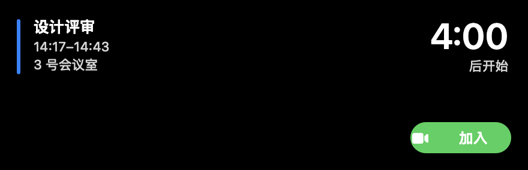
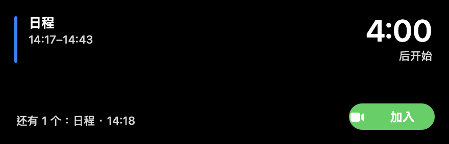

# 日程原生小样，2026-10-11

六种状态 × 两种系统外观，生产 `CalendarCard` 和 `CalendarCardText.make` 生成；输入全部自造，不读 EventKit、不打开会议、不显示窗口。`sources.json` 和 `frames.json` 绑定输入、源码、尺寸与窗口可见性。

当前源码的“加入”图标贴着左缘，文字独自居中；按钮将图标和文字作为整体居中后，画面更稳。SDK 的 `NSButton.imageHugsTitle` 就负责这件事，不需要自造按钮事件、命中测试或另一套绘制。候选同时声明稿里的底角 28，接进本轮共享尺寸协议。

| 当前 | 候选 |
| --- | --- |
|  |  |

共享屏幕状态的当前卡片：



真实纯核把当前和其他日程名称换成“日程”，地点清空；这些离线输入验证呈现结果，不能代替系统共享状态变化的现场验收。长标题、无地点、已开始及其他日程的样件均在对应目录。

**第三检查点已接入生产。** 图文整体居中和28底角与原候选一致，生产12帧在 `after/`；实际NotchPanel量得440×175.5、底角28。CalendarCardTests共9例34断言通过，包含拒绝授权、共享时隐藏内容、加入、来源停止、键盘与撤销输入。第二检查点的构建只适用于当时源码；本批完整构建与身份结果见第三检查点validation.json。

复现当前画面：

```bash
bash tools/design-qa/render-calendar-card.sh /absolute/output-directory
```

`candidate.patch`保留原小样修改，已接入当前源码，不要再直接套用。复现历史候选时才从其对应旧版副本应用；不会触发运行时接线。真实刘海、按钮点击、抢占恢复、VoiceOver 与系统共享切换在本轮均为 not_run。
