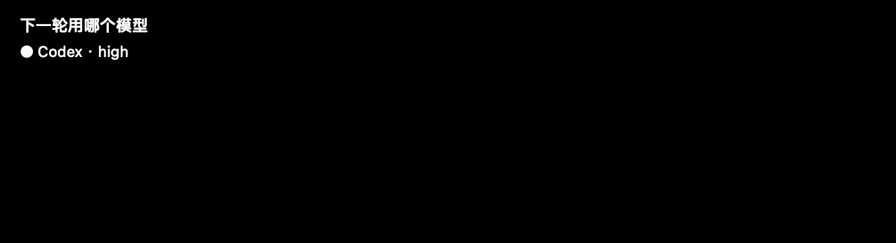
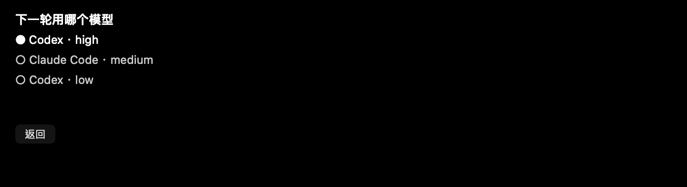
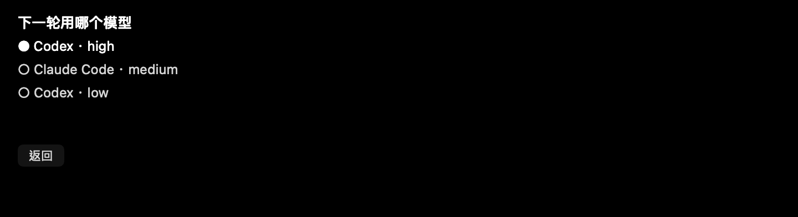
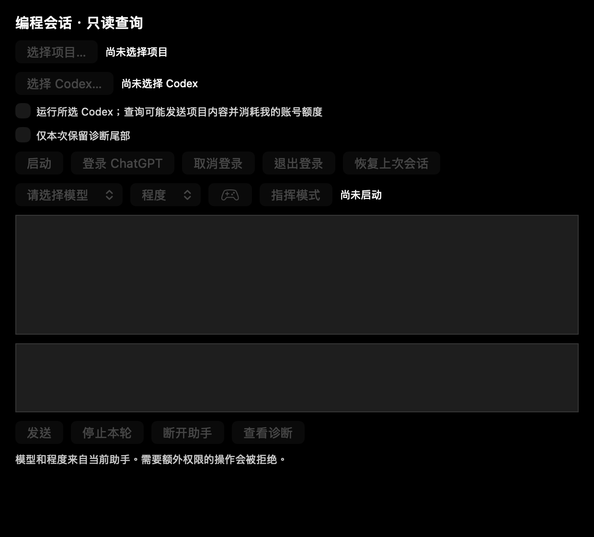

> 历史第三检查点。固定深色根已在[第四批](../2026-10-11-host-theme/README.md)收回实际黑色宿主；本页原PNG/输入摘要保留当时版本，不再声称匹配当前源码。卡片预览入口现使用生产Canvas根，完整宿主复现请用第四批入口。

# 指挥与会话的黑底可读性，2026-10-11

持续目标仍是 WindowShade 2 七条线的完整设计质量，本页是第三个检查点。生产视图的原生画面确认：浅色桌面外观继承进固定黑色刘海，导致提示和模型候选消失；会话页出现白色文本区，其他文字却在黑底上看不清。

同一组自造状态在两种桌面外观下运行：连接、模型候选、听写、草稿、完成、断开、未启动的会话页。所有模型标签、项目名称与声音样本都是fixture，不证明真实模型可用或音频来源在线。会话控制器只构造，不选项目、不登录、不启动助手、不发消息、不访问日历；会话页没有获得输入权，其按钮禁用是fixture状态。

| 修前：浅色 | 修前：深色 |
| --- | --- |
|  |  |


修正沿[设计文法](../../design-grammar.md)的既有边界：刘海固定纯黑，其余窗口跟随系统。指挥卡、会话卡只挂在这个宿主上，根视图采用现有授权卡同样的深色 AppKit 外观，使按钮、复选框和文本区一致；指挥副句白0.68，未选模型白0.6。没有另起宿主、外观开关或授权通道，没有改助手启动、发送、审批语义。

修后14帧已生成，主模型实际看过浅色模型候选、听写、草稿、会话页与深色连接状态；窗口均未显示，复制输入的摘要与当前源文件匹配。七种状态的浅／深父窗口输出PNG逐字节一致，摘要在 `theme-comparison.json`；这证明本组静态受控状态的一致性，不能推广到所有场景或动画。






检查结论以 `validation.json` 为准。静态卡片不能证明整颗岛的相机避让、抢占恢复和动画已通过，真机仍需单列。

预览入口由 DeepSeek 编写，限一个独立工具文件。它自报的语法检查不等于验收；主模型复核后补上 cwd、整模块编译参数、临时快照到原路径的摘要映射，再通过实际before渲染。产品设计、视图修正、样件状态和最终验收由主模型完成。该入口完整编译生产库，排除所有产品main，只运行指定fixture；C对象和二进制在各自WORK内隔离。

`before/sources.json`、`after/sources.json` 记录实际复制输入；`renderer.json` 记录运行二进制摘要（临时二进制在结束后清理）。`frames.json` 记录窗口均未显示。旧entry显式设视图外观，新entry只设fixture窗口外观，使产品根视图的深色策略能真实生效；修前产品没有根外观，两者继承效果等价。新entry还禁止fixture激活，避免Dock介入。这些差异不属于产品状态机。

复现：

```bash
bash tools/design-qa/render-native-surfaces.sh /absolute/output-directory /absolute/path/ConductorSurfacePreview.swift
bash tests/run-conductor-view-tests.sh
bash tests/run-appkit-tests.sh CalendarCardTests
bash prototype/build.sh --check
```

剩余检查继续保留：模型选择页、指挥详情页和会话列表有外观继承线索，先做原生样件，不根据颜色名批量换色；播放器/文件架、设置上手、窗口、遥控与安全电量隐私继续按持续接管入口推进。

会话页读清只是底线：本轮是无输入权的未启动fixture，不能用这张禁用状态图判断完整流程。下一轮需补真实可操作的自造状态，再检查主次动作、登录与取消何时出现、空白文本区和诊断入口；目前结构仍偏工具面板，不算设计收敛。
