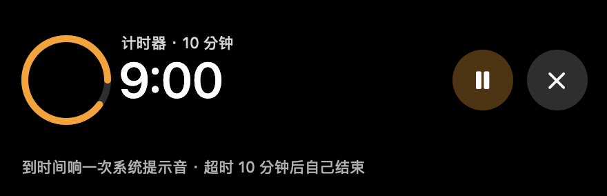
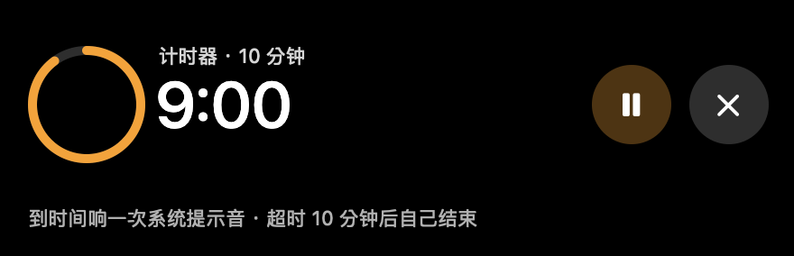
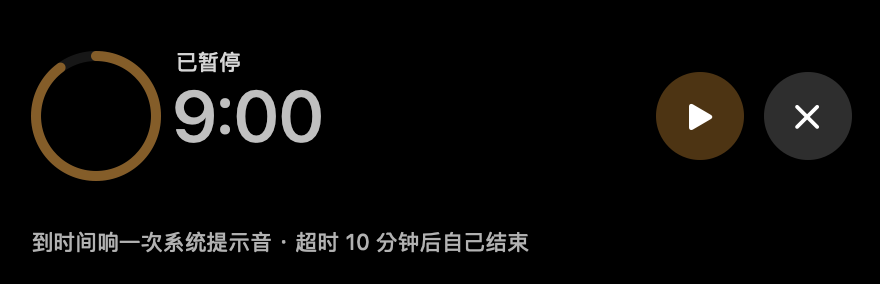

# 计时器与菜单栏测量，2026-10-11

这是持续设计接管的第二个检查点。完整目标仍包括共同刘海入口、各活动、设置与上手、窗口动作、遥控与指挥、安全和隐私；没有把高级感缩成一张卡的改动。

计时器按 [原稿](../../design-drafts/日历电量计时器.html) 恢复比例：时间到内容 52（实体刘海总高 85.5），大卡底角 28。共享宿主读卡片的内容下限与底角；默认仍是 68／24，播放器与文件架继续声明原有 28。虚拟刘海原有圆角行为保留。没有新增展示主人或另起宿主。

原生画面确认了进度环起点错误，已改成从十二点钟顺时针走。运行、暂停、超时、提醒和选择分钟共五种真实模型状态，分别在浅／深色外观下渲染；字体、按钮及控件由生产卡片直接生成。

| 修前运行 | 修后运行 |
| --- | --- |
|  |  |

| 修前时间到 | 修后时间到 |
| --- | --- |
|  |  |

暂停：



这组画面只证明卡片内容，没有显示任何窗口。`frames.json` 记录尺寸、读屏内容和 `visibleWindow=false`，`sources.json` 绑定当时的源码。渲染脚本从生产文件提取卡片原文，不引入展示接线与系统授权；首次整文件编译因拉入 Presenter 运行时依赖失败，修正了预览入口，未修改产品依赖。

菜单栏测量另查出真实缺陷：原实现把隐藏、透明和已经收回的自有胶囊都当作遮挡。用实际 NotchPanel 建立失败用例（7项中4项失败），再只收集可见且非全透明的自有面板。可见面板仍须保守避让，后台 AX 测量只拿主线程的不可变帧，不传 AppKit 窗口。

原假设按证据分开：隐藏面板的残留帧已由原生用例证实；多屏坐标与 AX 取点仍需现场复核。历史“外接屏排在下方时不出现”的症状不能因这次修复就标通过。

原生回归的恢复记录保留工具失败：新增宿主夹具初次 CGFloat／Double 比较类型不匹配，已只修测试类型；两个并行测试共用 C 对象导致绿例编译输入被改写，已将 C 源／头文件／模块与对象放进各次 WORK 快照再重跑。修改在途 runner 又导致计时器接续位置错误；编译已完成，直接执行同一份生成的二进制，完成了实际回归。它们不能算产品功能失败或通过。

当前检查已通过：计时器实际宿主与输入 4 例 23 断言，遮挡绿例 7 项，计时纯核 7 例 31 断言，重试策略 12 断言；完整优化构建及既有门禁退出 0，既有并发警告和长文案仍在，不宣称没有技术债。检查记录与源码摘要见 `validation.json`。原生整颗岛、动画、真机排列矩阵仍为 not_run。这些条件不妨碍继续检查其余设计表面。

复现：

```bash
bash tools/design-qa/render-countdown-card.sh /absolute/output-directory
bash tests/run-appkit-tests.sh CountdownTimerCardTests
bash tests/run-appkit-tests.sh MenuBarObstructionTests
bash tests/run-menubar-retry-tests.sh
bash tests/run-countdown-timer-tests.sh
bash prototype/build.sh --check
```
