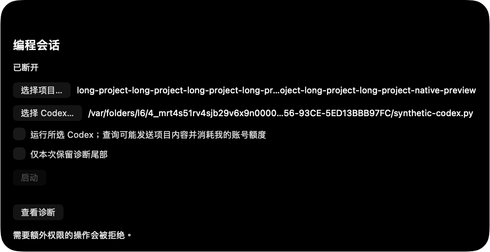
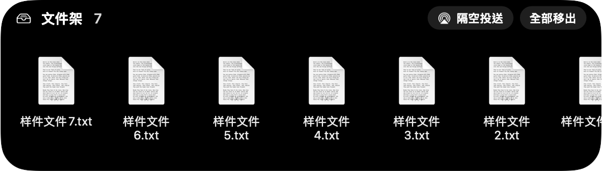
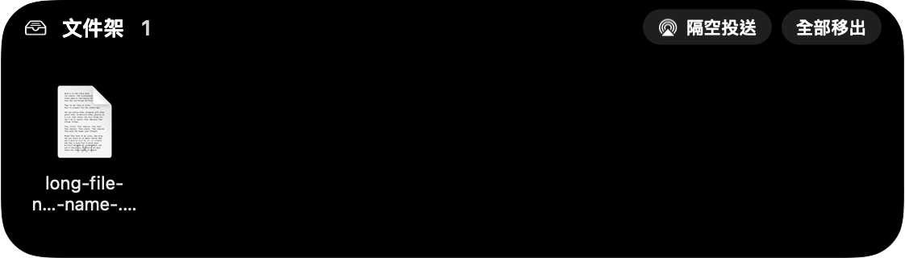

# 状态反馈与文件架实际基线

完整七线设计目标仍 active。本批修了两处可达状态表达，并首次收齐文件架实际布局；不是发版或整体设计通过。当前分支与此前未提交改动保留，未签名、安装或替换日常 App。

播放器查询不到输出设备时，原来直接返回，用户看不到结果。现在沿已有“播放到”列表显示“暂未找到设备”，保留原有收回入口，再次打开会重新查询；失效／撤销后不能继续查询。空列表沿既有一行令牌，内容420×120.5、宿主421×154；未新增面板、设置或硬件尺寸。会话清理中显示“正在断开”，确认回收后显示“已断开”，删除面向用户的“直属进程已终止／回收”；回收、诊断与状态机路径保留。

同一不可变生产输入编出的原生样件，产出会话14帧／86输入导航与宿主检查，以及播放器12帧／4控件报告。独立消费者验证空列表可返回、重查得到5个合成设备、失效／撤销不再查询、计时器清理；六对播放器浅深父外观PNG一致。会话断开帧的实际status为“已断开”。这些是当前生产视图与本地action的静态证据：透明、离屏、非活跃应用，不证明真人操作、读屏播报效果、真实音频输出、动效品质或签名Swift6执行期隔离。

DeepSeek只改两句控制器状态并运行原有合成stdio流程，完成回执／原断言退出0；主模型核对实际差异、回收路径和当前原生断开画面，承担媒体实现与独立验收。既有NowPlaying视图测试的旧“空查询不开列表”断言已改为有反馈且可返回，语法检查0；本批未运行其完整旧套件，因为开头会写持久UserDefaults。新返回与重查行为由本批隔离原生fixture实际验证，未借用旧套件的通过结论。

文件架使用实际FileShelfController／Store／View，独有系统临时目录内自造文件，开关仅进程volatileDomain生效。8帧覆盖空架、单项、七项和长ASCII名字，4对浅深父外观PNG一致。内容560×126.5、宿主561×160、76×104格子及六格半视口符合既有稿；结束先解除观察、停止store、flush，再删自己的目录并恢复volatileDomain。仅类型图标，未生成文件缩略图，也未触发打开／显示位置／系统预览／隔空投送／剪贴板／实际拖放。初始空架是强制挂载的布局基线，真实openCard拒绝空架，不能据此认定空白是可达缺陷；全部移出与撤销另待实际样件。

长名出现了两个省略号且扩展名不可见，不验收为设计通过。实际Core输出`long-file-n…-name-.txt`仍保留扩展名；用当前11点字体与同样68点宽、word wrapping和13点行高测量，完整显示需要39点高，生产drawName只给28点，最后一行再被截断。下一批应按真实字宽安排最多两行并保留扩展名，避免重复省略；不能靠增加卡宽或纯字符数测试掩盖问题。字体测量源码和JSON与原生失败画面保留。

第一次反馈消费者把会话frames对象当成数组，退出1；保存原消费者与失败回执，修正数组读取后对同一原生结果通过，不重新构造“绿样件”。这是QA解析错误，未归为产品故障。之前各轮原始失败与绑定文档保留。

完整优化`prototype/build.sh --check`持久退出0（UTC 2026-10-11 09:13:01），515 Swift＋4辅助输入未变；Swift6／strict-concurrency／warnings-as-errors参数保留，本地化206键、隐私登记725点／隐私页同步／文案门禁通过。现有警告仍保留，不能称文案债务清零；签名App执行期未验。其余工作继续：文件名排版、清空／撤销及失效项，真实封面取色、超过5个设备的列表，未登录／错误状态、长模型名和实时回复滚动，以及原蓝图其它表面、共同五态、多屏和动效。
