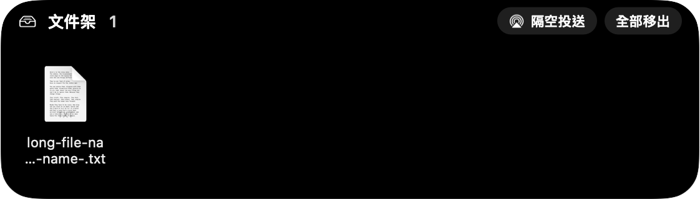
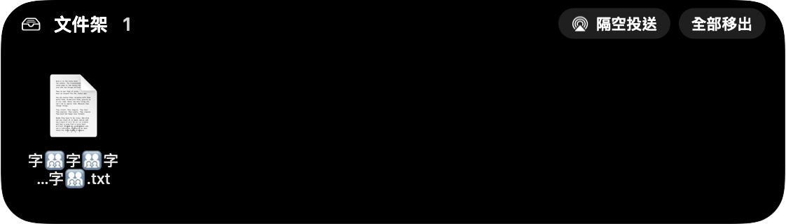
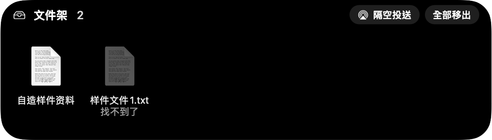

# 文件名按实际字宽排版

本批修复文件架实际长名的双省略与扩展名丢失。完整七线目标仍 active，当前不是整体设计通过或发版。

名字改为用当前11点字体测量，每行最多68点、最多两行，逐行居中绘制；长名只省略一次，常见扩展名保持完整，不把`.txt`拆开。失效原因占第二行、用次级文字色。原始文件名和数据不变，显示中的换行字符转为空格，隐私遮蔽分支保留；卡片560×126.5、格子76×104及六格半视口不变，不靠扩大卡片避开问题。

前后是同一长ASCII样件名、同样的实际生产宿主。修前的Core输出需要39点高，绘制区只有28点，再次截断后扩展名丢了；修后字体测量和画面均确认两行内、仅一次省略，`.txt`可见。

宽字和组合emoji也收了实际画面，不能只用“西文字母大概几格”判断是否放得下。

实际Controller／Store／View样件共18帧，覆盖初始空架、单项、七项、长ASCII、宽字、组合emoji、找不到的文件、全部移出和撤销。9对浅深父外观PNG一致。两组原生移出按钮action检查确认：只从自造架上移出，原文件仍在；撤销能恢复；输入失效／撤销后再派发移出动作不改变清单。清空与撤销画面由实际控制器调用驱动，未模拟真人点击撤销按钮；初始空架是强制挂载布局，不声称真实openCard允许空架。

字体检查从当前生产源原字节提取helper，使用真实AppKit字宽，以Swift6／strict-concurrency／warnings-as-errors编译。16个单／双行边界用例覆盖普通、长、宽、中文、组合emoji、隐藏文件和显示换行字符。独立原生消费者读取实际tile.nameLines，核对每行宽度、扩展名、一次省略、原因与状态。没有复制另一套排版算法当作生产测量。

DeepSeek提交的QA草稿仅parse0：它复制了旧排版逻辑，转义了字符串插值，撤销路径不可达，清空计数和资源清理也不可靠。原稿与SHA保留；主模型拒收后重写全部样件，承担产品设计、实现与独立验收。没有把工人的语法通过说成原生通过。

所有资料来自独有系统临时目录，文件架开关只在进程volatileDomain生效；结束先取消清空／待删、解除观察、stop／flush，再移除自己的目录并恢复domain。只用类型图标，没有实际缩略图或真实文件打开／分享／系统预览／剪贴板／拖放。原生fixture沿现有AppKit入口使用默认Swift5／未优化编译，完整构建另以优化Swift6验证；两者不能混作签名App执行期证明。透明离屏样件证明静态生产布局与本地action，不能替代真实硬件、指针／键盘／VoiceOver、隐私共享状态或动效品质。

当前完整优化`prototype/build.sh --check`持久退出0（UTC 2026-10-11T09:25:16.441259+00:00），515 Swift＋4辅助输入未变，Swift6／strict-concurrency／warnings-as-errors参数保留。本地化206键、隐私登记725点与隐私页同步、文案门禁通过；原有警告仍保留，签名App执行期未验。后续继续有封面的播放器取色、超过5个输出设备、会话未登录／错误／长模型名／实时滚动，以及原蓝图其它表面、共同五态与多屏动效。
