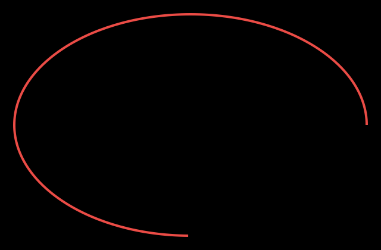
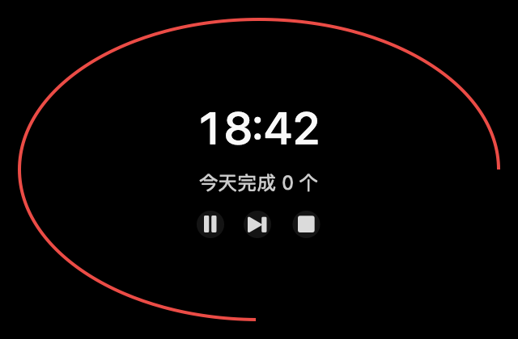
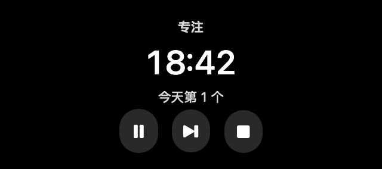
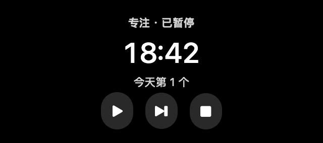
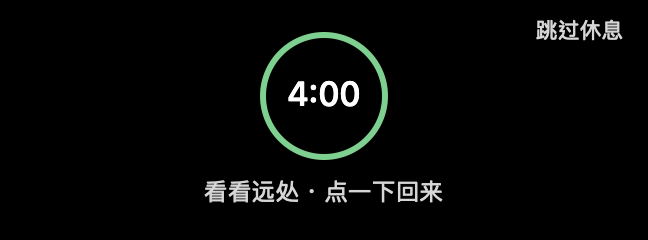

# 设计接管：先把刘海里的番茄钟修正

2026-10-11，源码基准 `5daafb2`，现有工作分支 `codex/ws2-remote-gpt6-handoff-20261007`。这是首轮设计修正，不是 WindowShade 2 完成或发布声明。原七条线、刘海仲裁与授权边界继续有效。

目前的问题不只是细节欠打磨。已有稿、实现和交付口径并未一直对齐：同一块固定黑底的卡片用了随系统变色的文字；专注详情把紧凑态的进度环放大成椭圆，却漏掉最基本的“专注／已暂停”。先把用户真正看到的一张卡修好，再沿共同入口往下查。

## 首个修正与证据

依据是 [番茄钟稿](../../design-drafts/番茄钟.html) 中的展开状态与 [功能规格](../../pomodoro.md)，生产实现是 [FocusTimerCard.swift](../../../prototype/App/FocusTimerCard.swift)。稿规定状态、时间、今天第几个、三个圆按钮；绿色呼吸光环属于休息。文字在纯黑底上应在系统两种外观下都清楚。

| 问题 | 本次结论 | 证据 |
| --- | --- | --- |
| 浅色外观下文字消失 | 已修正；卡片文字与控件明确用白色，次句白 0.6 | 同一原生卡片，修前／修后 `light-focus.png` |
| 专注卡多出一个大椭圆 | 已移除；紧凑两耳的进度环继续由原活动视图负责 | 修前 `dark-focus.png`；修后专注卡 |
| 缺专注与暂停状态 | 已补“专注”和“专注 · 已暂停”，读屏内容同步 | 修后 `light-focus.png`、`light-paused.png`，`frames.json` |
| 今天完成几个与正在做第几个混用 | 空闲写完成数；专注写当前序号 | 修后空闲／专注卡，真实 FocusTimer 模型 |
| 内容高 210，占用空间过多 | 本轮候选压到 142，四层内容仍有独立位置；休息内容高仍为 120 | 修后 8 张原生画面；这些是内容尺寸，不含实体刘海 |

修前，浅色外观：



修前，深色外观：



修后，浅色外观：



修后，暂停：



修后，休息：



尺寸 320×142 是本轮可检查的实现候选，并非从示意稿的 `cqw` 反推出的硬件令牌。宿主原有圆角、肩、相机避让与弹簧未在这次重定；不把卡片矩形截图当整颗岛的外观。是否还应更宽、更扁，留到同一构建的真实刘海画面再决定。

## 之后按什么顺序纠正

优先恢复共同入口的一致性，再深入每条线。不能把每一轮都变成“又加了多少功能”。

| 顺序 | 表面／问题 | 当前证据与下一步 |
| --- | --- | --- |
| 1 | 刘海五态、两耳、相机避让、外接屏 | 本轮只核对源码与规则；真实宿主五态尚未重拍。先验证已记录的“外接屏排在下方，胶囊不出现”，再调整形状。该问题来自旧验收记录，未在本轮复现 |
| 2 | 番茄钟、计时器、正在播放、日程、文件架 | 首张番茄钟已修。计时器到点卡被共享 68 点下限撑高、圆角与稿不同，`design-grammar` 已有账；逐张做原生前后样件，判断共同规则还是特例，不继续堆尺寸分支 |
| 3 | 设置、菜单、上手入口 | 核对每行的符号、短句、权限退路与设置分组。现有 `c3-window.png` 只能作历史线索，不当当前源码已通过的证据 |
| 4 | 窗口：收起、看一眼、放回、卷轴 | 把实时画面、静态画面、只有 App 图标三种退路画清楚；检视失败后是否仍找得到原窗口。最小化截图缺口沿用已有 KNOWN-GAP，不因缺图假报回归或成功 |
| 5 | 指挥、遥控、审批 | 以 10-08 遥控器稿为准核对输入与取消。默认只读、审批新动作门槛与目标绑定继续保留，不为了画面顺畅放宽 |
| 6 | CarPlay、身份与离开就锁、电量、隐私 | 分别核对入口、退出、真实状态与拒绝／读不到的画面。人手长按与热插拔已有后续成功记录；相机断流等未验项仍独立保留 |

另已纠正一条会误导接线的旧账：文法 NP-4 仍写播放器借用 `pomodoro`。实际 `NowPlayingCardPresenter.open`（当前第 1115 行）使用 `nowPlaying`，租约主人表也已有这一项；它仍属于主动打开层，仍用同一个宿主。本轮修正文档，不把已经分开的播放器和番茄钟重新耦合。

七条线仍在：窗口、实时活动、电量、CarPlay、指挥模式、刷脸解锁、隐私。这张表是设计检查顺序，不是功能删减，也不是上述各线已通过审查。用量与进度稿在设计目录仍标“待出”，先补可检查的画面，不能用源码已经接进 App 来代替设计完成。

共同判据只有几件事：状态看得懂，动作知道会发生什么，做错能回来，内容接在同一个宿主上，正常与失败都能说实话。实现的来源与价格不作为正确性证据；主模型负责判断、实际差异与最终核验。

## 复现与证据边界

```bash
bash tools/design-qa/render-focus-card.sh /absolute/output-directory
bash tests/run-focus-surface-tests.sh
bash prototype/build.sh --check
```

渲染器调用生产 `FocusTimer`、`FocusTimerHost` 和 `FocusTimerCard`；协议声明从生产文件精确提取。它建立未显示的 AppKit 窗口来提供布局与绘制上下文，不开启产品、不操作系统窗口、不执行计时效果。`frames.json` 记录尺寸、读屏内容与窗口未显示；`sources.json` 绑定源码哈希。修前／修后各保留 8 帧，涵盖空闲、专注、暂停、休息与系统两种外观。

离屏渲染已执行；目视核对修前浅深专注卡、修后浅色四态与深色专注／休息卡：文字可读，四层内容和动作没有重叠。其余帧保留供复查。它不证明真实宿主形状、变形连续性、点击、焦点、VoiceOver 实际朗读或抢占恢复。减少动态效果、增强对比度与实际硬件矩阵本轮 `not_run`；休息呼吸的时间过程本轮 `not_run`。视觉结果与构建／回归结果分开记在 [validation.json](validation.json)。

未提交、未推送、未签名、未替换日常应用。旧任务与设备缺口保留在 `.statem/history-design-20261011/`，后续工作从本文件与当前源码继续，不重新顺次套旧交接补丁。
