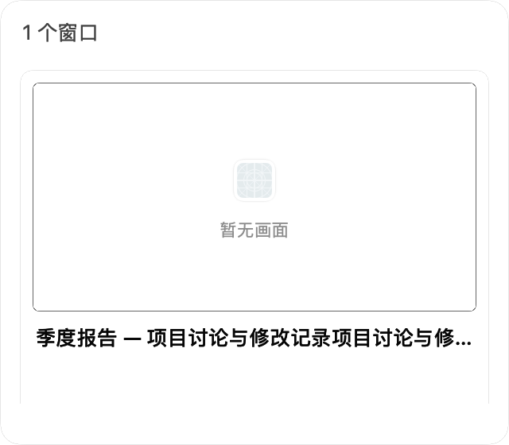
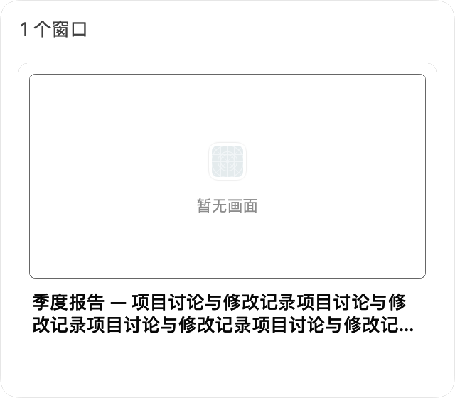
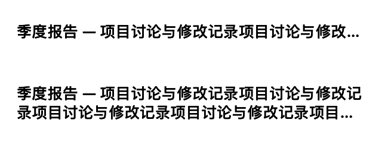
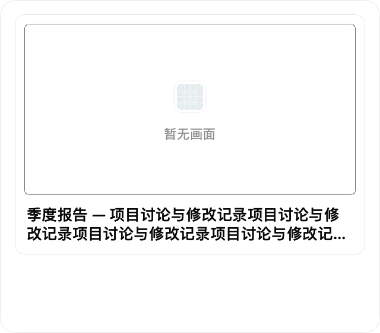
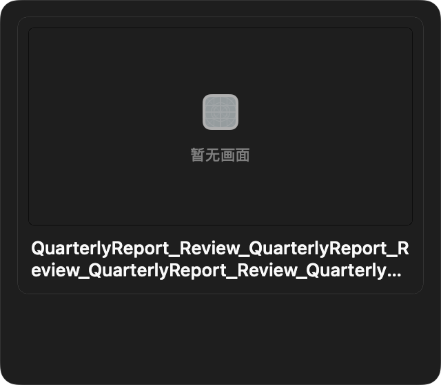
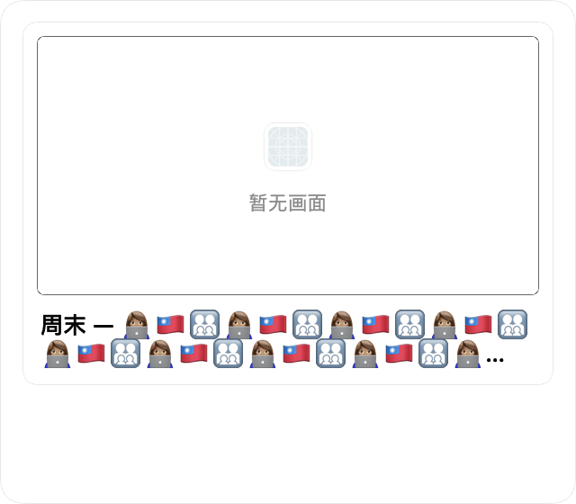
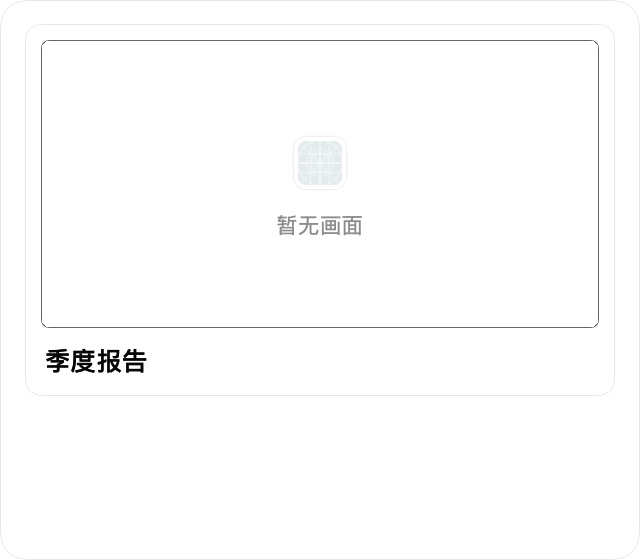

网格卡片的长窗口名现在真正使用两行，末行仍省略，完整标题仍在提示里。原标题虽是wrappingLabel、最多两行且高34点，设置tail模式后实际cell.wraps=false，只画一行，第二行空着。生产只把breakMode改为wordWrapping，保留maxLines2、truncatesLastVisibleLine、字号、tooltip与其它布局。

独立最小AppKit探针使用生产WindowBrowserTypography的13点字，同一296×34字段、同一长中文：tail实际wraps=false、wordWrapping=true。探针PNG和原入口/输出保留。再经实际WindowBrowserContentView与真实Card测量，修前16帧实际279×34、lineHeight16、maxLines2、wraps=false；修后相同默认参数16帧的文字框、卡片、字体和完整tooltip全部与修前一致，实际wraps=true，主模型看过两行实际PNG。

随后查明控制器实际调用纯WindowBrowserGeometry.derivedParams派生标题高度、状态区和页头。本批追加同一生产纯接口：短标题18点，长标题34点，无状态单窗口不重复页头；没有为了长标题给短标题留第二行。默认/派生两套参数、短标题/长中文/无空格英文/组合emoji四种输入、paper/system两材质、浅深外观共32最终帧。选择的320×280视口是QA尺寸，不代表真实Dock面板放置和高度计算已经验收。

消费者读取真实Card字段与cell属性、实际字体行高、文字/卡片矩形和完整tooltip，比较16对默认参数前后尺寸，核对派生参数两行空间。主模型看过中文/英文/emoji/短标题实际PNG。系统材质只验真实contentHost与几何，缓存图不证明玻璃合成。未读取真实窗口、App图标、缩略图或直播画面；合成PID不存在，只有系统通用图标。

自有窗口alpha0、离屏、不激活，按生产先挂宿主再update。仅ContentView/Card与纯派生参数，不构造控制器/实际Panel、不会启动窗口动作、AX/截图服务、权限请求或输入监听，也不写偏好。未验真实Dock放置、缩略图/动态材质/拖放/焦点/键盘/动画或签名Swift6执行期。

本批为一行生产修正，主模型直接实施与验收，未另派工人。完整优化构建和当前来源身份见validation.json；独立原生入口使用Swift5，不冒充签名Swift6执行期。未签名、安装或发布，全蓝图目标仍active，下一批继续共同实时活动表面。

当前完整优化`prototype/build.sh --check`于UTC 2026-10-11T10:42:39.567951退出0，519构建来源与最终518原生来源均匹配；完整并发/警告视为错误参数、本地化/隐私/文案门禁保留。
