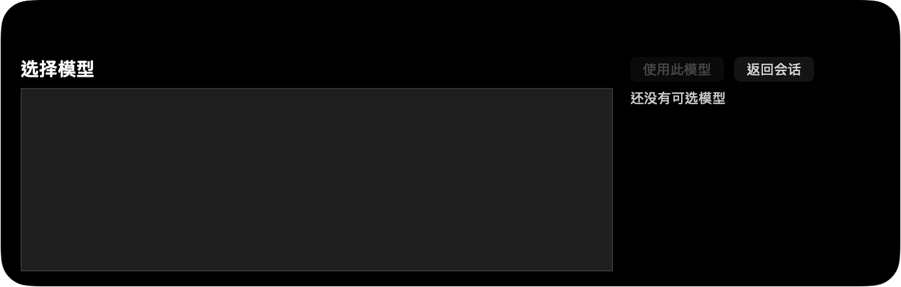
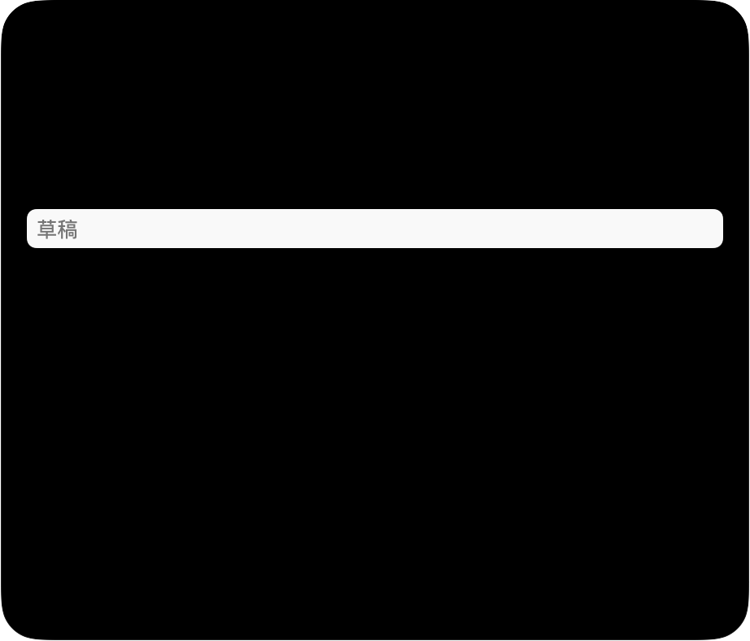
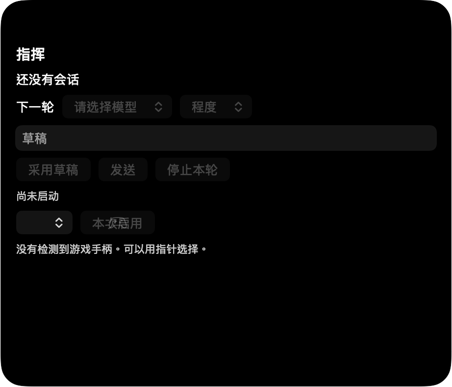
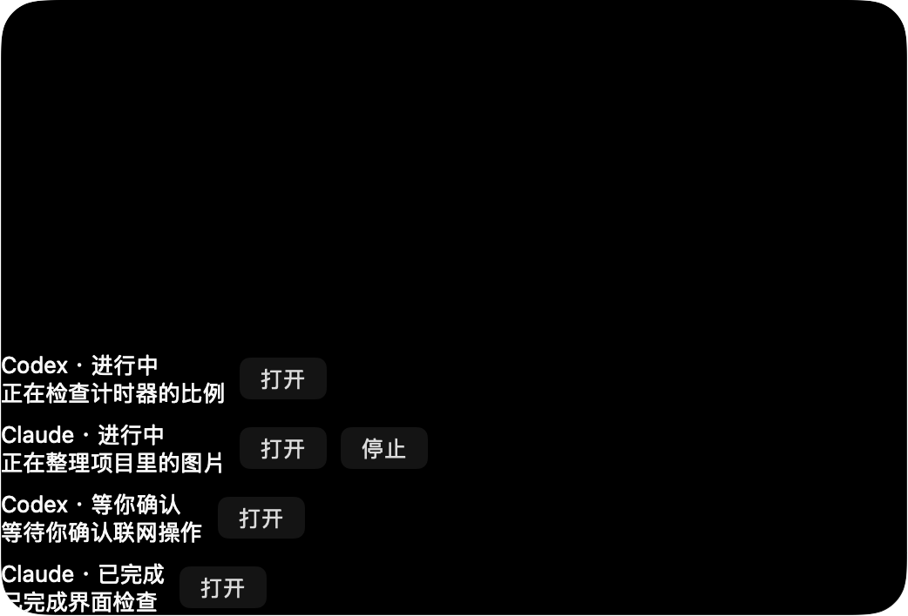
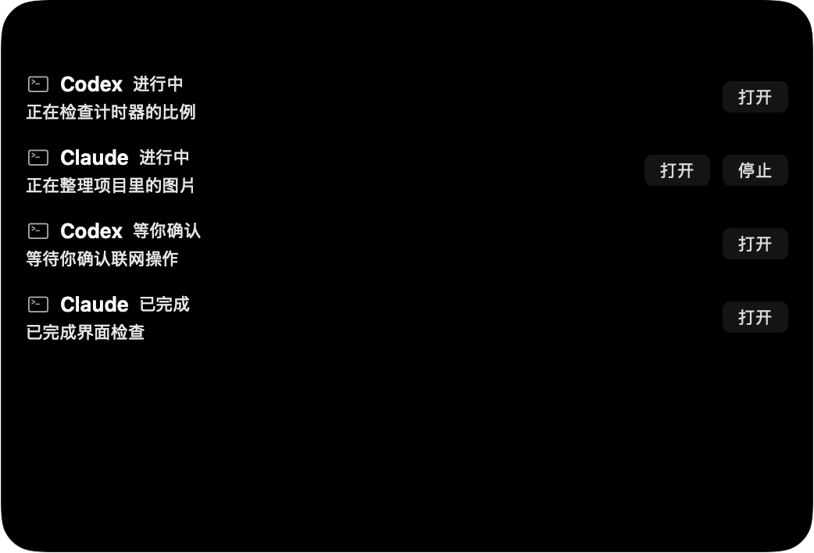
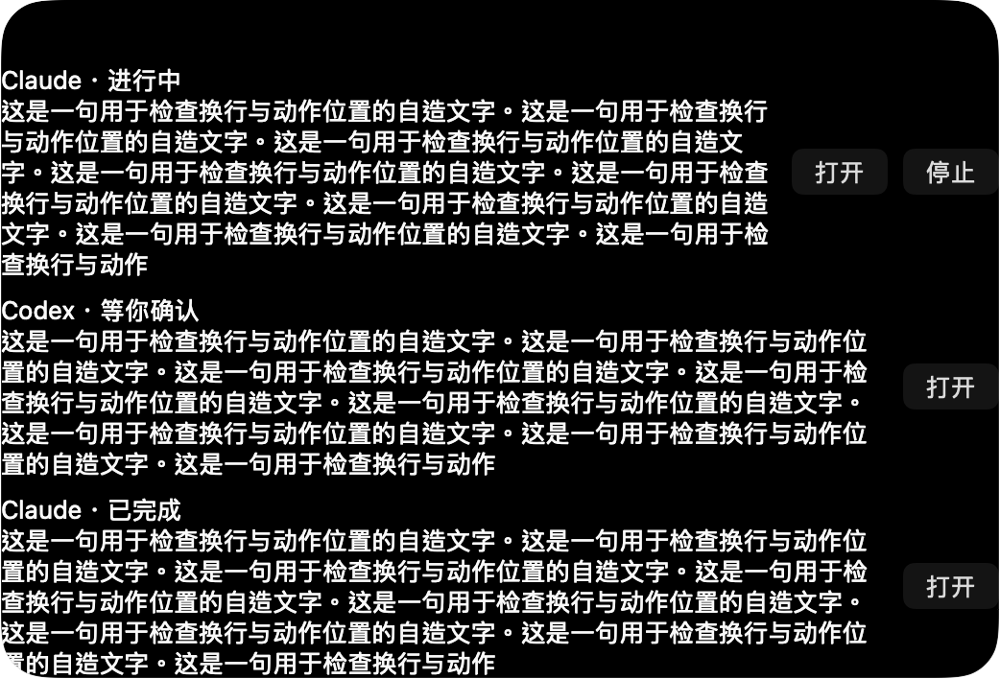
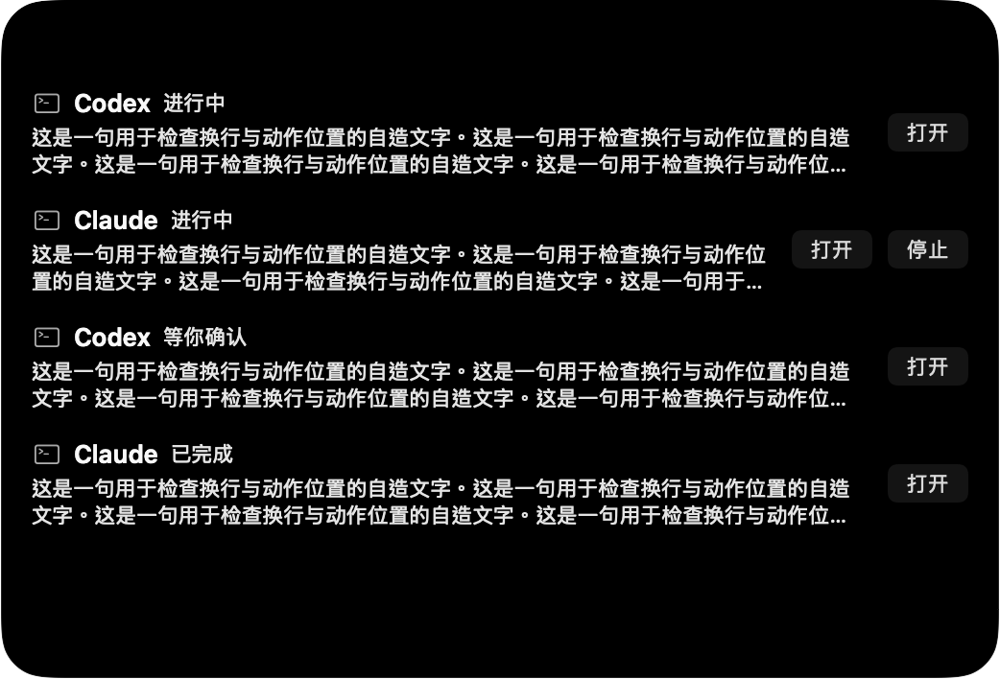

# 黑色宿主与会话列表，2026-10-11

第四个设计检查点。原生构造首先确认模型选择页会崩溃：提示字段尚未加入右侧容器，就激活二者的宽度约束，AppKit 抛 `NSGenericException`，进程退出134。已修构造顺序。[首次失败](first-crash/render.log)与当时二进制、输入摘要保留；下列before是修构造顺序之后、改外观之前的基线。

| 浅色父外观：修前 | 修后 |
| --- | --- |
|  |  |
|  |  |

问题属于共同入口：固定黑色硬件表面继承浅色原生控件外观。现在由实际 `NotchCanvasView` 根规定深色，上一轮指挥卡、会话卡的重复设置已移除。设置、欢迎窗口和App全局外观没有改。这组14帧覆盖三个新页面及上一轮两张卡，14/14继承深色；七种状态的浅／深父窗口PNG逐字节一致。它只证明这些静态受控状态，不能推广为所有表面、增强对比度或动效已通过。

会话列表原来把助手、状态、摘要挤在一块，同样大小的文字贴着左边和底边，最后一行被裁切。按《看与指挥》把“谁、什么状态、最后一句、动作”分开：顶部开始，16点横边距、12点上下边距，助手13点半粗，状态和摘要11点次级白，摘要最多两行并省略，动作组靠右。没有另加玻璃、卡片材质或新宿主。

| 深色修前 | 修后 |
| --- | --- |
|  |  |
|  |  |


无会话时只留现有空状态，内容高用协议的68点下限，保留520点宽；有会话仍320点内容高。相机带、底角、刘海五态及仲裁规则没有重定义。最初修后画面仍有动作漂移，实际布局探针发现AppKit拉宽的是按钮组；已用组本身的hugging固定其宽度，重新渲染，前两次画面与最后产物分开保留。

模型目录为空时改说“还没有可选模型”，暂时不可选则说“暂时不能选择模型”。没有手柄就不露空设备选择器和启用按钮；现有设备选择、确认、输入权和模型选择的守卫保持。当前无后端样件不能证明真实模型可用。

原生列表动作检查7/7通过：观察会话没有停止；仅自管且运行中的会话可停；点击携带正确会话；撤销输入、删除行和revoke后的旧按钮无效；最多64行。它用真实生产NSButton与绑定方法，不执行任何真实会话动作。检查结果在 [after/session-action-checks.json](after/session-action-checks.json)。

实际 `NotchPanel` 位于屏幕外。宿主按自身逻辑orderFront，因此 `isVisible=true`；逐帧检查不与任何屏相交、应用不活跃，不把它写成“窗口未显示”。不启动产品main，不访问真实项目、日历、账号或后端。相机带33.5只属fixture；真机刘海、不同屏排列、输入焦点、VoiceOver和动画仍not_run。

当前完整Swift6优化构建与既有门禁退出0，持久回执在 [build-exit.json](build-exit.json)；源输入、日志、边界以 [validation.json](validation.json) 为准。既有编译警告与46条超长副句仍保留。

```bash
WINDOWSHADE_PREVIEW_REQUIRE_DARK=1 bash tools/design-qa/render-native-surfaces.sh /absolute/output /absolute/path/HostSurfacePreview.swift
bash prototype/build.sh --check
```

会话页仍有过多平级动作、空文本区和启动前后混排；[合成后端的14张实际相位基线](../2026-10-11-owned-phases/README.md)已通过单控制器连续连接、回执与清理核验，用于下一批设计；已选模型状态不准、空草稿可发送和底部提示裁切仍待修。列表还缺稿中可辨认的项目名，不能用内部projectID冒充名称。七条线、整岛形状与真实动效的持续目标仍active，本页不宣称“高级感完成”，没有提交、签名、安装或发布。
