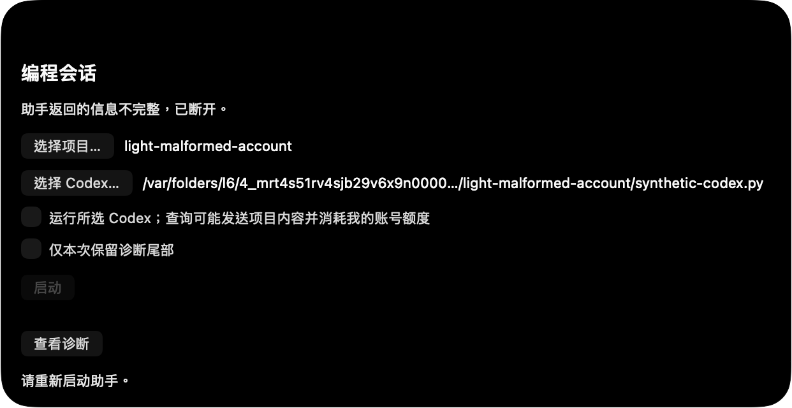
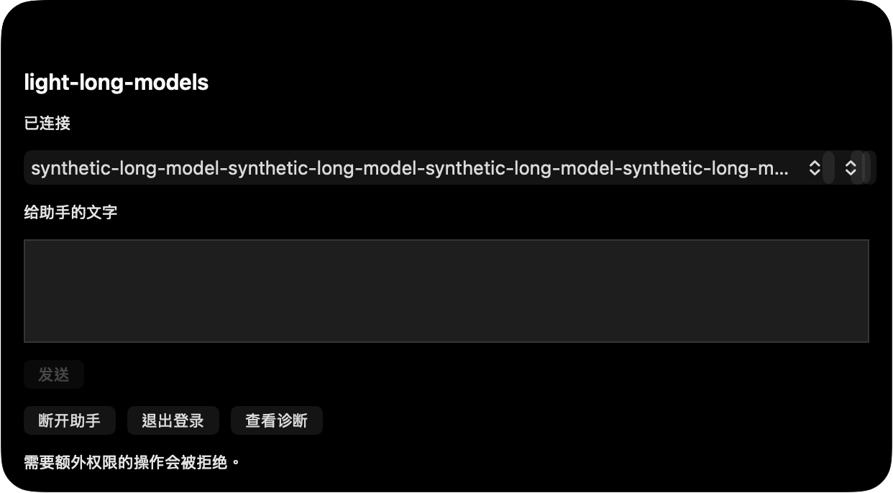
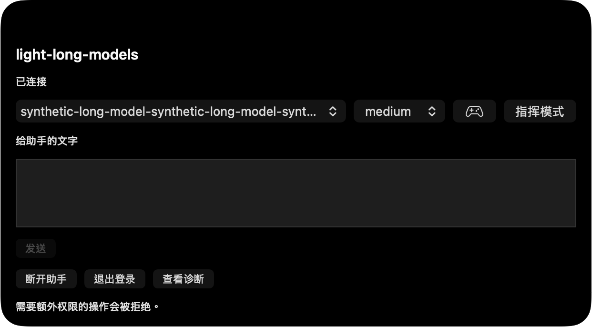
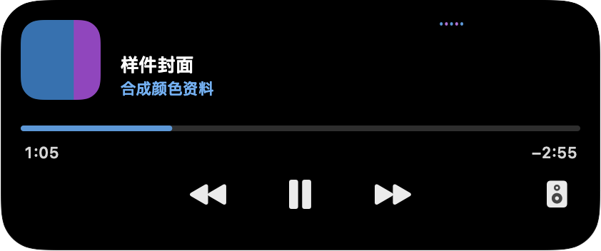
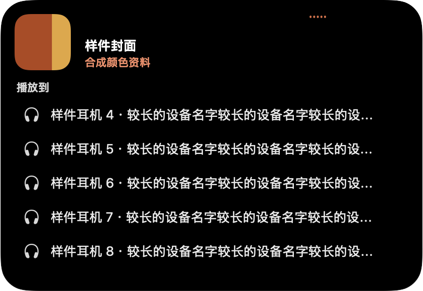

本批修了两处真实问题：助手被拒绝或返回信息不完整时，具体原因会在进程回收后消失；长模型名会把同行三个操作压到零宽度。播放器已有的封面取色与八设备列表也补了实际原生画面。整个七线设计目标仍在推进，本批不是整体通过或发版。

断开原因现在保留到收尾结束，重新启动才清掉。权限不符显示“助手设置与当前权限不符，已断开。”，信息不完整显示“助手返回的信息不完整，已断开。”并提示重新启动；手动断开仍显示“已断开”。授权门、迟到回执拒绝、私有状态清理和进程回收规则没有放松。四个受控 stdio 场景修前两个失败、修后全部通过；原有完整会话流程也通过，错误回执后草稿保留且发送禁用。

长模型名的失败不是越界：所有控件仍在卡片里，但思考程度、模型列表和指挥入口的宽度都是 0。现在固定操作行宽度，让模型名先收缩，三个操作保持内容所需空间；完整模型标识留在菜单和提示里，不改变实际选中值。卡片宽度和原有层次不变。

播放器使用自造的 128×128 暖色、冷色和灰色封面，经过实际 PNG 解码和 palette，再交给生产 NowPlayingCard；覆盖暂停、移除封面、空作者和八设备列表头尾。16张实际帧、8对浅深父外观 PNG 一致，实际作者文字颜色与当前 palette 输出相符。八行列表直接滚到末端，能看到第八行；这是静态端点，不冒充真实滚轮或设备切换。播放器本批没有产品改动。

会话未登录、权限不符、信息不完整、295字节模型名和模型列表共10张实际帧。原生样件沿实际宿主和控制器入口运行，使用独有临时后端和项目；结束均回收自己的进程并删除临时资料，没有打开浏览器或登录。未登录和错误状态不能发送。离屏、不活跃、透明的生产样件只证明静态布局与受控状态；真实登录、焦点、鼠标/键盘/读屏、媒体与硬件矩阵、动画和签名 Swift6 执行期检查仍未验。

首次错误流入口路径失误、原生入口的两处编译错误和旧文案断言失败均保留。第一次画面消费者只查越界，漏掉了零宽度操作；补查后实际红例成立。修后又发现 QA 把图标按钮按文字按钮的50点宽度判断，纠正为图标所需空间并保留失败检查。没有把这些 QA 错误当作产品缺陷，也没有只留最后一次绿例。

DeepSeek 只执行现有纯 palette/内存 PNG 解码套件并写报告。桥接记录实际两次退出0，报告原称一次；原稿和记录保留，主模型按真实次数纠正，核对12项输入 SHA，没有再次运行。数学对比度断言不等于实际帧的像素对比度验收。设计判断、两处产品修正、原生样件与独立验收均由主模型完成。

当前完整优化 `prototype/build.sh --check` 于 UTC 2026-10-11T09:49:46.314045 退出0，519项构建来源与518项原生来源均匹配当前文件；Swift6、strict-concurrency、warnings-as-errors 参数保留。本地化、隐私登记与隐私页同步、文案门禁通过，原有警告保留。原生 fixture 使用默认 Swift5 未优化编译，不能替代签名 App 的 Swift6 执行期证明。原蓝图其它表面、共同五态、多屏和动效仍需继续。
