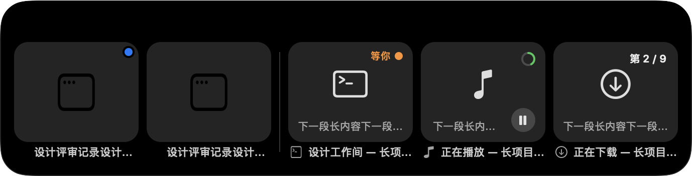
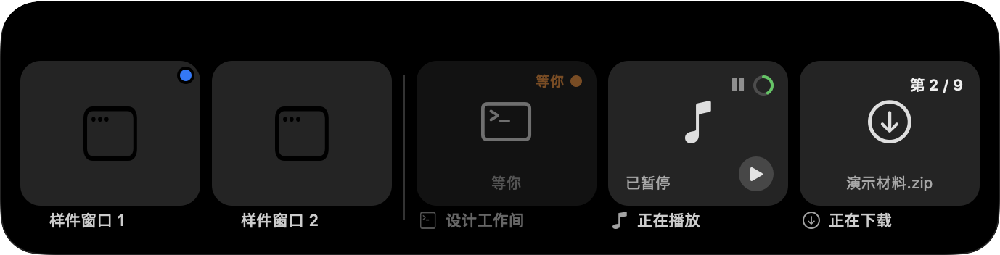

刘海的共同一排已建立当前原生静态基线：窗口左侧、活动右侧；仅窗口、仅活动、混排、长内容、未知进度、过期和已结束，共12帧。生产没有改动。实际NotchCanvasView与NotchTileView绘制，活动数据经生产NotchRow.ongoingCells投影，形状沿现有展开路径。六对浅深父外观图一致，Canvas实际固定深色。

第一版样件给等待会话和音乐都人为塞入百分比，制造了文字重叠；实际会话来源进度未知，音乐不显示百分比数字。这不是生产缺陷。baseline与invalid-payload入口原件保留，不纳入视觉通过。projected版纠正数量，再把长标题放到投影之前，确保可见标题和完整读屏名称一致；最终产物在final。系统窗口符号仅为合成图标，黑色符号不能用于判定真实App图标质量。

独立消费者通过，校验12实际tile数据/尺寸/顺序、124点单元、分隔间距、未知/过期/结束、会话与音乐数量策略、隐藏不激活宿主及518来源身份；主模型查看实际长内容、混排、未知和状态图。最终包装进程已经终止，日志以PASS 12结束，但压缩前工具输出被截断，数值退出码没有可靠保留；清理后的临时二进制不存在，未伪造退出0，也未为补记数字重复编译。消费者退出0有独立新回执。

复用第十四完整优化构建退出0（2026-10-11T10:42:39.567951+00:00）：519项构建输入SHA逐项与当前文件相同。该构建证据仍在上一批，build-inputs为本批复核副本。

只验静态表面，不启动真实来源控制器、Panel、输入监听或动作；不读真实窗口/媒体/文件，不触发书签图标路径，不写设置。真实App图标、现场仲裁、动画、焦点、点击/读屏执行和硬件矩阵未验。全目标继续，下一步状态面板长内容与信息层次。DeepSeek未参与，本批是主模型设计核查。
