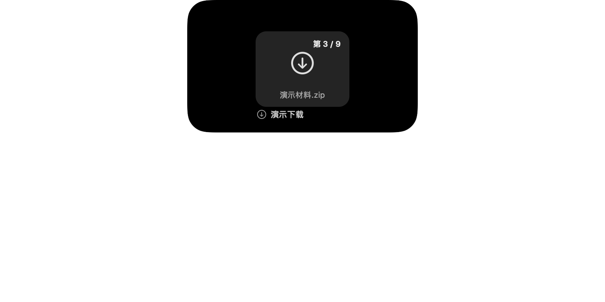

实际 Swift 6 原生样件已完成展开、原地更新、替换、收回与打断路径：16 个状态、13 次完成回调，全部在主线程。普通模式的过期收回回调没有执行；减少动态效果模式直接到目标形状。身份不变时，同一格数字从第 2/9 更新成第 3/9；替换后为第 4/9。没有发现需要修改产品的缺陷。

这是自有 alpha=0、未显示、离屏 NSWindow，运行自己的 NSApplication 主线程事件泵，delegate=nil、prohibited。没有产品入口、Panel、Controller、权限、真实来源或系统输入事件。弹簧取自实际 Motion.notchSpring，减少动态效果只用现有进程内诊断 override，最后恢复并读回确认。没有写系统偏好。

第一版样件漏了数量专用入口，实际消费者报告旧 2/9。主模型核对生产 refreshOngoingRows→NotchPanel.updateOngoingQuantities→Canvas.updateOngoingQuantity 后纠正样件；不把夹具错误当生产缺陷。原始红例、入口与输出保留。首次编译因 QA async 直接读 Thread.isMainThread 失败，改同步 MainActor 点采样；没有放松 Swift 6 编译参数。

DeepSeek承担独立标准库消费者。它只跑语法检查，不能作为行为验收；主模型发现并修正把 open-settled 快照名当回调名，以及减少动态效果过渡矩形的两处错误预期，再对实际输出验收。修前消费者与 worker 原结果保留。

wrapper显式加入可选 --swift6，使用 swift-version 6、strict-concurrency complete、warnings-as-errors；默认 Swift5保留。此工具链仍输出并发 warning，日志保留，不能描述成无警告；实际入口以编译条件拒绝非Swift6，执行期没有隔离崩溃。最终原生退出0、消费者退出0，518输入当前；产品没有变化，独立复核第十七批519完整优化输入SHA相同，复用当时正式退出0，不重复完整构建。

这些结果证明所测控制路径，不证明可见动画品质。模型层、隐藏窗口 presentation、cacheDisplay PNG 均不能冒充真实合成、签名产品生命周期、多屏或硬件验收。相机避让、完整仲裁、真实来源、读屏和输入仍未验。整体设计接管继续。
