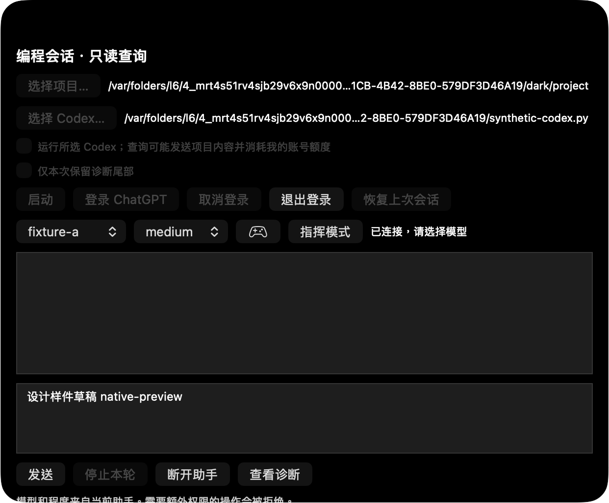
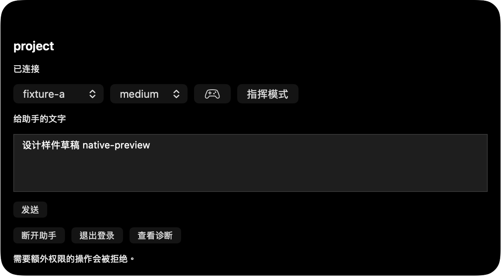
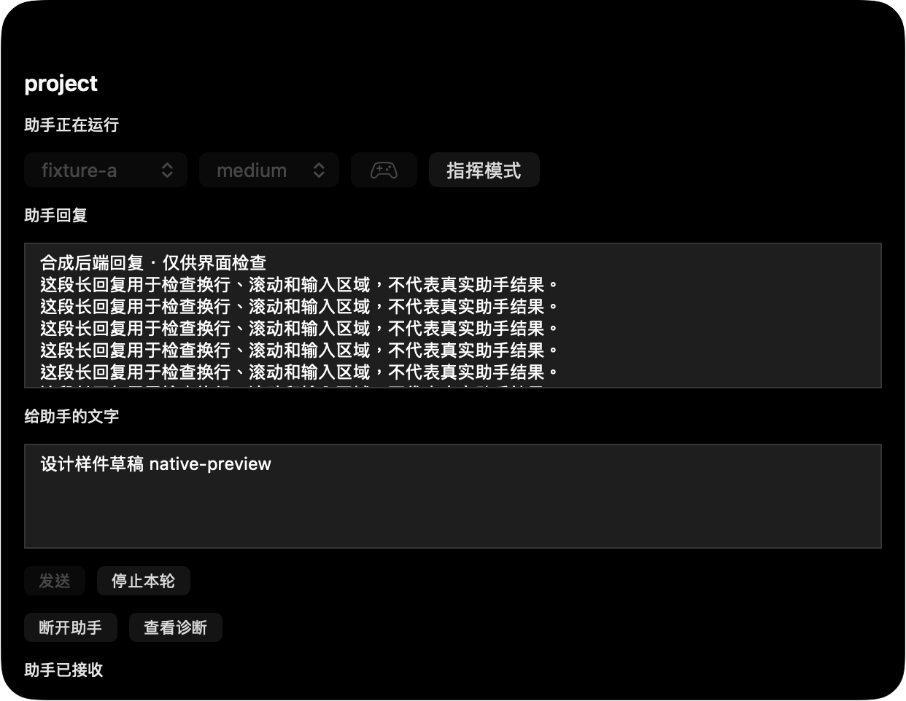
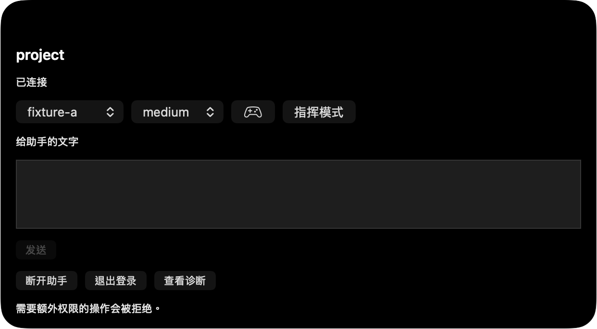

# 会话页的操作层次，2026-10-11

第五设计检查点，持续目标仍active。沿《看与指挥》《指挥模式》，把准备、状态、输入与实际执行分开，保留单一刘海宿主、既有权限、组合输入和提交守卫。

旧页把项目/程序选择、登录、恢复、模型、回复、草稿和诊断全部堆到同一屏。它请求560点内容，实际宿主最多480，底部内容落在外层滚动区域之外的首屏；上一批静态截图里的“裁切”不能证明滚动失效。本次让常用输入和状态先进入首屏，而不是加高宿主。

启动前呈现项目、Codex与原有运行同意；连接后以真实项目目录名为标题，完整路径留在tooltip。只有当前资格成立的登录、恢复、停止动作才出现。普通无回复时不画空输出框；接收到回复或主动打开诊断时显示原有可滚动文本区。草稿与发送为主操作，断开/账号/诊断在下一行。

实际选好模型后，ready且已有发送资格的状态改为“已连接”，保留运行、完成、拒绝等既有状态。UI禁用空白、超出65536 UTF8字节和未完成组合输入的发送；控制器提交时仍独立验证。渲染同步控制器的草稿，但保留被拒的超限本地文字；撤销后旧按钮和输入不可用。

内容按实际stack fitting height加原有上下14点边距请求尺寸，上限480不变。仅当当前window是正在呈现自身的NotchPanel时，调用现有interactionSizeChanged，使用原有expand/calm弹簧。这里没有新的宿主或独立产品窗口。

第一版14帧与既有会话流程测试通过，但固定420仍有空白，保留为first。第二版实际14帧已查看：启动前286、输入页309；两套外观各19项输入投影检查通过，所有可见文字位于内容范围内。这些中间样件与最终产物分开保留。

DeepSeek只增加同一实际视图的输入检查。主模型独立发现并补正组合输入被超限状态混淆、两外观报告覆盖、缺失按钮默认false误过和写证据失败吞错；生产结构、草稿同步和宿主尺寸均由主模型实现。当前原生QA使用完整生产库的非优化Swift5 fixture，正式门禁另用优化Swift6，不能混称同一二进制。

硬件刘海、多屏、真实输入焦点、VoiceOver、真实助手与动效品质仍not_run。七条线的完整目标不缩小，没有签名、安装或发版。

最终 [after/frames.json](after/frames.json) 的14帧已核对，准备页286点、无回复输入页309点、长回复页447点。六种可比状态的浅／深父外观PNG逐字节一致；启动前两轮实际phase与选择不同，不混称同一基线。长回复有意在**自造临时后端副本**追加，原始fixture保持；原始SHA和生成后端SHA不同，生成脚本一同保留，不能再套用上一批“复制字节相同”的判断。

| 上一批草稿页 | 当前草稿页 |
| --- | --- |
|  |  |





两套外观共52项输入/尺寸检查通过。同一实际NotchPanel从343点外框扩大到497点动画容器，停稳后恢复343点，仍在屏幕外且应用不活跃。此为窗口尺寸端点与状态检查，不证明真实动效节奏或外观品质。输入项的raw expected/actual记录有些使用predicate与原始属性不同表达（例如inactive=true对应NSApp.isActive=false），按源码里的布尔条件与实际值核对，不按两个文字相等判通过。

第一次增加按钮tracking后，进程虽退出0，只留下1帧，完整相位/清理回执缺失且屏幕外／不活跃的组合检查失败，当时未分别记录二者，不能认定是哪一项。该批保存在first-tracking-failure，**拒收**。独立小AppKit探针显示performClick后未执行后续await，换成派发同一按钮action后恢复；这是本机异步fixture的观察结果，不推广为产品reaper缺陷或一般AppKit规则。最终只派发本地诊断action，不点击发送/登录，不模拟真人输入；实际面板始终alpha=0，尺寸探针还放在桌面层之下，逐帧确认屏幕外/不活跃。isVisible仍true，不能写成“未orderFront”或真实屏幕上可见验收。

[外部语义检查](accepted-check.log)同时要求14个正确相位、52项检查、回复、发送状态、可见文字范围、回收/临时清理及当前518项输入身份；它实际拒绝了那份“退出0但缺回执”的产物。[正式优化构建](build-check.log)有[持久退出0](build-exit.json)，515 Swift与4辅助输入匹配；[现有会话流程测试](final-core.log)最终源码退出0。生产Swift6执行期主线程检查仍未在真实签名App上验，不将非优化Swift5 fixture结果挪用过去。

```bash
bash tools/design-qa/render-native-surfaces.sh /absolute/output /absolute/path/OwnedPhasePreview.swift
python3 tools/design-qa/check-owned-preview.py /absolute/output
bash tests/run-conductor-owned-flow-tests.sh
bash prototype/build.sh --check
```

本批未覆盖signed-out/登录失败、超长项目名、不同屏幕可用高度、真实指针/IME焦点、VoiceOver与实时回复跟随滚动。超限草稿时导航动作的反馈仍需独立检查。下一步补这些失败反馈，同时推进播放器/文件架；完整七线和共同刘海目标继续保留。本批没有发版，详见[当前产物绑定](validation.json)。
