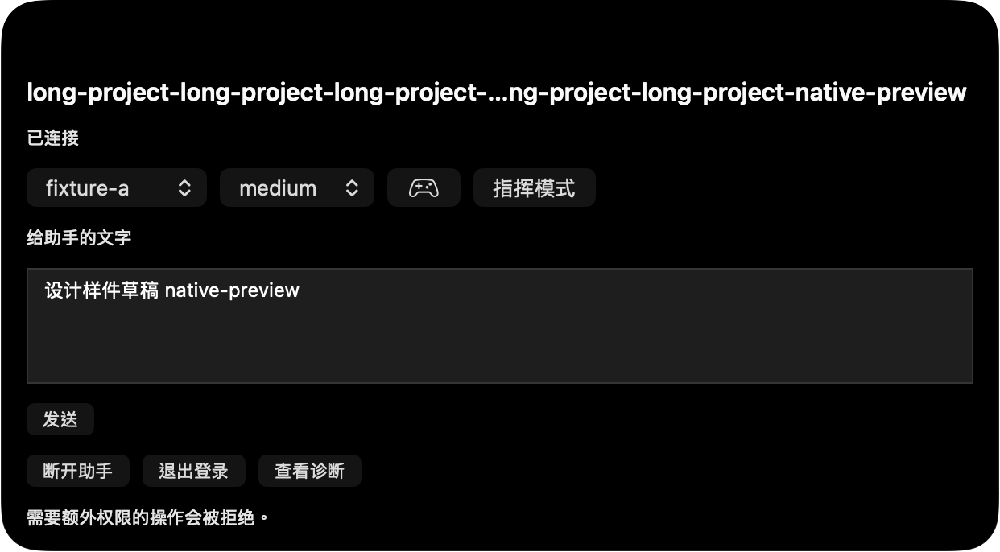
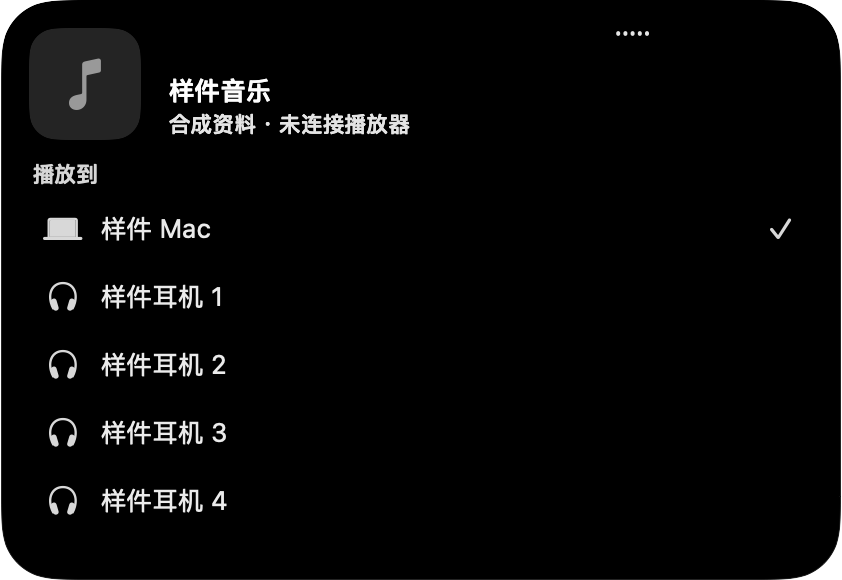

# 会话导航与长标题

会话页的按钮状态现在与动作一致：超限草稿或中文组合输入未完成时，不能进入模型列表或指挥页；回到有效文字后恢复。直接派发旧 action 也不能绕过保护。没有接上目的页的按钮禁用。长项目标题和准备页字段限定在现有卡片宽度内，用中间省略保留首尾，完整路径仍在提示中。这一批由主模型设计、实现并验收。

这是实际生产视图、实际控制器和合成 stdio 后端的压力样件。14 张相位画面、86 项输入／宿主尺寸检查通过，独立消费者核对当前 518 项原生输入与资源清理；六对同相位浅深父窗口 PNG 字节一致。超过 200 字符的目录名在准备、已连接、运行、完成与断开阶段都没有撑出内容区；内容高仍为 286／309／447，没有新增硬件形状或窗口。只检查了这些刺激，不代表任意项目名或可用屏幕高度均已验。

新增检查经过真实 NSTextView 和 NSButton target/action：65536 UTF‑8 字节仍可导航，增加一个“中”达到 65539 后两页禁用；被拒文字留在本地，控制器保留最后接受的草稿。组合输入期间不跳页或采用未完成文字，提交组合文字后恢复；有效导航每次只回调一次，过期／撤销视图不回调。动作只派发给本地记录闭包，不点击发送、登录或授权。旧第五批样件没有这些导航回执，新消费者实际以退出 1 拒收，未套用旧绿灯。

[输入原始测量](after/dark-input-checks.json)、[相位与标签边界](after/frames.json)、[消费者结果](accepted-check.log)、[旧样件拒收](reject-old.log)。原生 renderer 为完整生产库的 Swift 5 未优化构建；透明、屏幕外的 NotchPanel cacheDisplay 图像不证明可见真机效果、鼠标命中、焦点、VoiceOver、弹簧品质或已签名 Swift 6 App 的执行期隔离。

完整优化 Swift 6 构建持久退出 0（2026-10-11 08:19:55 UTC），本地化、725 个隐私读取点登记、隐私页同步及文案门禁通过，生产输入未变。构建参数未撤，仍有原有编译警告／文案债务；这不证明签名 App 的执行期隔离。[构建回执](build-exit.json)、[完整日志](build-check.log)。现有 stdio 控制器流程按未变输入复用第五批证据，身份对账见 [记录](reused-core-identity.json)；本次变化的 NSView 不是那套流程测试的编译输入。

DeepSeek 只读核对播放器与文件架入口，初稿部分推断没有读到实际代码，未作为缺陷或验收采用。主模型保留 [原稿](deepseek-media-original.md) 后纠正；[下一批输入边界](media-boundary-review.md)只是准备记录。播放器已有本批原生基线，文件架仍未采样；本批没有改两者产品实现。

播放器另收了播放、暂停、直播、长标题、空设备查询和五行设备列表，共 12 张无封面实际画面，六对浅深外观 PNG 字节一致。两组实际播放 NSButton 守卫检查通过：本地回调一次，过期和撤销后不回调，撤销后计时器为 0；没有接系统播放命令。独立消费者核对当前 518 项输入与内容／窗框尺寸。[播放器结果](media-baseline/accepted-check.log)。正常内容 420×142；窗框整点包围为 421×176。五行列表内容 420×256.5，窗框 421×290；这些是本批受控几何，不新增硬件令牌。

空设备查询实际保持播放卡且没有反馈，仍待修；有封面取色、超过五行滚动、输出切换／跳转／音量、真实媒体流和动效未验。首次路由表达式编译失败，之后错误把窗框当内容宽、把五行当三行，均为主模型样件错误；[编译失败](media/native-exit.json)、[顶层判据失败](media-repaired/native-exit.json)、[首帧尺寸诊断](media-diagnostic/failure.json)、[行数判据失败](media-rows-failure/failure.json)与原始入口均保留，没有据此改产品或把失败批报通过。最终采样器完整记录尺寸，几何由独立消费者按稿判定。

整体目标继续。下一批处理会话断开文案、未登录／失败状态、长模型名与实时回复滚动，播放器空设备反馈与有封面状态、文件架安全原生样件；同岛五态、动效、多屏和原七条产品线继续保留。未提交、推送、签名、安装或发版。
