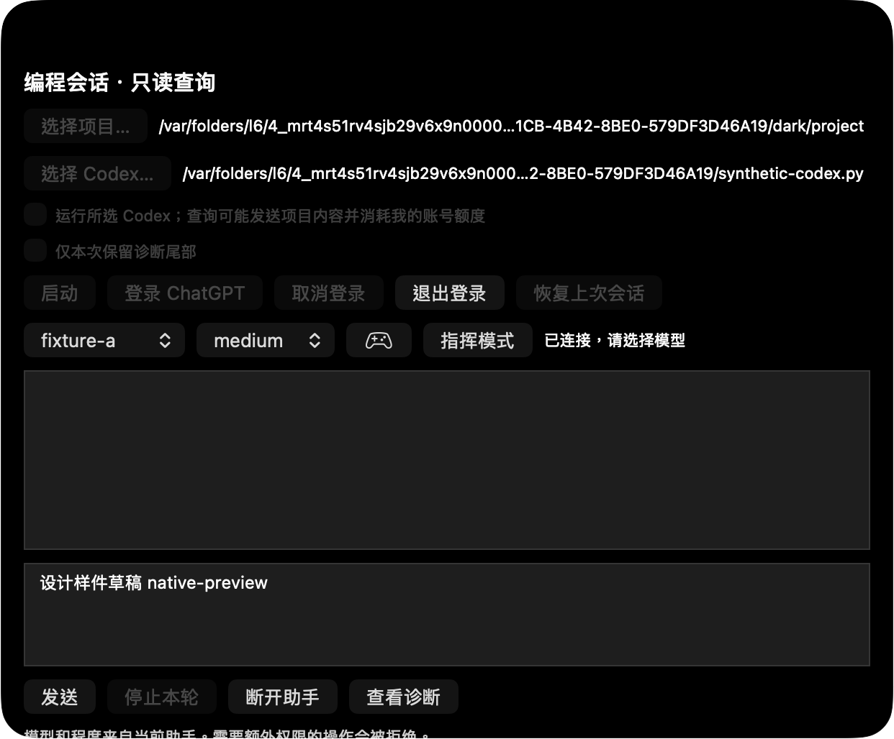
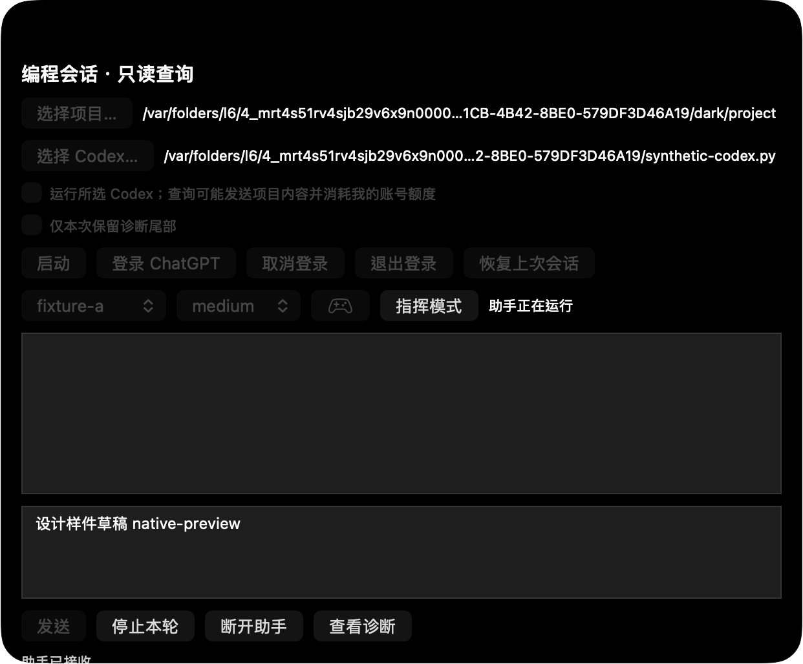

# 会话流程的原生基线，2026-10-11

当前真实 `WS2OwnedLaunchController`、生产会话视图和实际 `NotchPanel`，通过已有合成 stdio 后端走过两套父外观，共14帧。一个控制器连续连接两次，与 `WS2AppRuntime` 的所有权一致。首轮启动前是idle，第二轮启动前是stopped，不把两者混称idle；完成态由真实合成完成回执到达，不把interrupting冒充completed。

[相位与清理](owned-phases.json)、[界面状态与按钮](frames.json)、[构建输入](sources.json)、[实际渲染日志](render.log)、[退出0](exit.json)保留。复制后端的真正SHA256与原始fixture一致，518项输入与当前源码一致。唯一系统临时目录已删除，直属进程已回收；逐帧应用不活跃且窗口不与屏幕相交，实际宿主仍orderFront，不称隐藏窗口。没有真实账号、项目、助手、网络或登录操作。

| 草稿 | 运行 |
| --- | --- |
|  |  |

画面是设计问题的基线：已选模型仍提示“请选择模型”，空草稿的发送按钮可用，配置/登录/运行/诊断动作混在同一层，底部提示被裁切。大块空输出和启动前后结构尚未收敛。这些问题未在本批改为通过；接下来按现有《看与指挥》《指挥模式》重排。

原生fixture入口由DeepSeek起草，首版把16位非SHA256校验误命名、复用撤销后的视图、把interrupting当终态，且最初临时路径约束不适合生产祖先配置门禁。主模型取消并接手修正，使用系统唯一临时目录、真正SHA256、每帧新视图和明确终态；不放宽生产配置守卫。第一份失败/被拒产物在 `.build/design-owned-phases/rejected-worker` 和 `baseline`，修正版首次两控制器实验的第二次连接超时、清理标志未全通过，保存在 `controller-baseline-first`，不能沿用为绿灯。当前改为产品的单控制器架构后通过，不据此宣称两控制器问题已在生产修复。

独立现有流程测试 [core-flow.log](core-flow.log) 退出0，断言未改。入口原漏掉当前WireJSON依赖，首次编译失败保留；只补源文件接线后通过。该测试覆盖会话恢复/收养、过期目标、草稿、重连、发送/中断回执等行为，不替代真实助手体验。

原生预览使用完整生产库的非优化Swift5 fixture构建，生产Swift6优化全包门禁另见[第四检查点](../2026-10-11-host-theme/README.md)。输入焦点、原生模型点选、VoiceOver、刘海动效、多屏和真实助手仍not_run。14帧以frames.json清单为准，不按旧输出目录残留PNG计数。

```bash
bash tools/design-qa/render-native-surfaces.sh /absolute/output /absolute/path/OwnedPhasePreview.swift
bash tests/run-conductor-owned-flow-tests.sh
```
