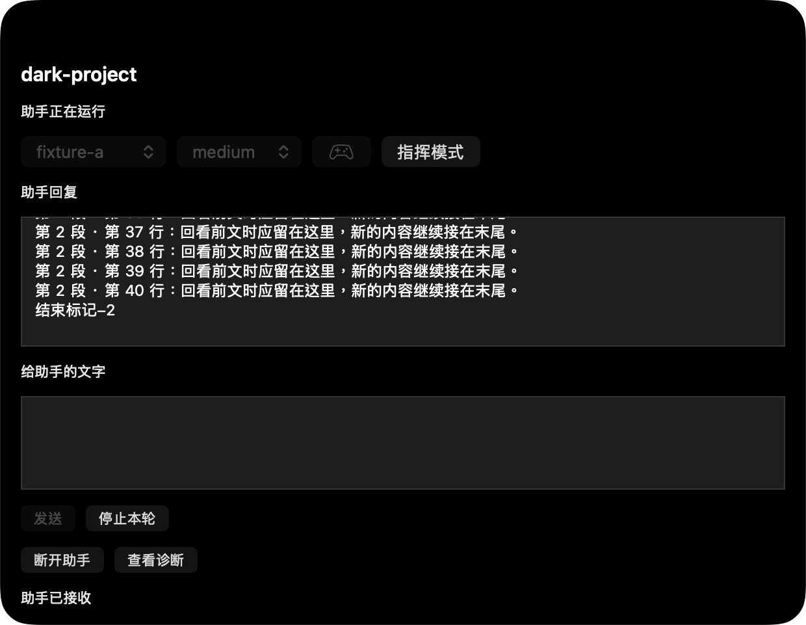
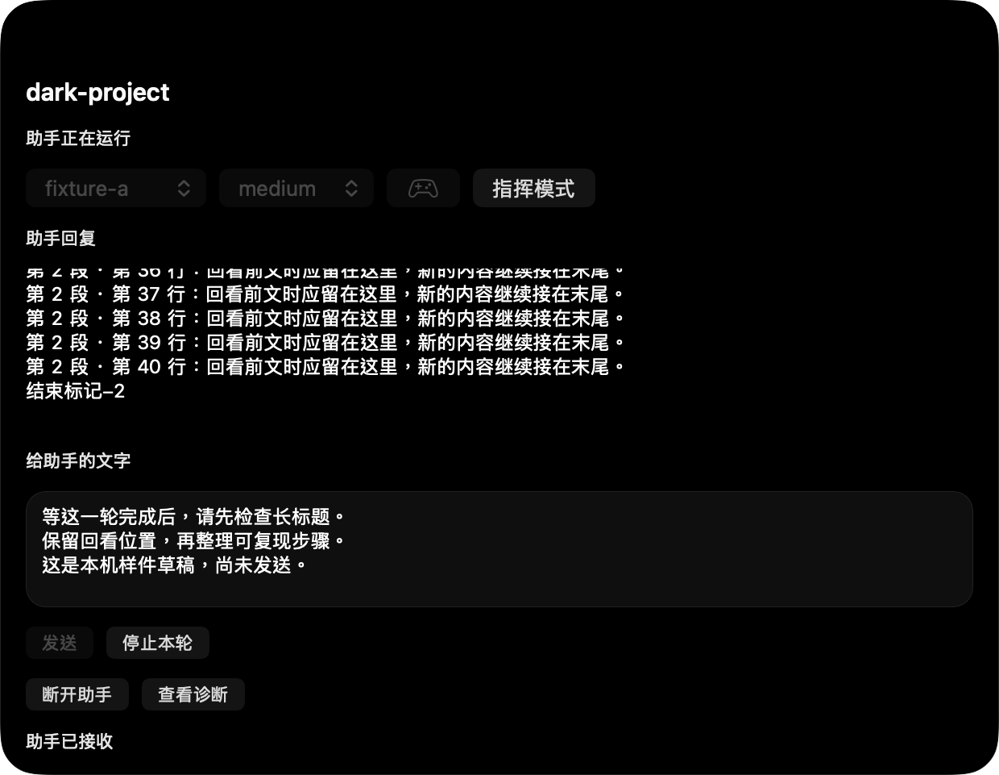

助手回复与待发送草稿的层次已经分开：回复沿用指挥页的透明正文，不再装进系统矩形框；草稿沿用总稿草稿表面的12点圆角、浅底与细边。保留12点字体、回复100点与输入72点高度、原NSTextView和全部发送/组合输入/草稿逻辑。

并未发现追加滚动的生产缺陷。用真实WS2OwnedLaunchController、实际onChange→scheduleRender和同一张已挂载WS2OwnedSessionView，连续追加五段受控文字：首次长回复和底部追加贴末尾，顶部回看位置不动；距末尾30点保留位置，20点跟随。两种父外观各6帧，最终12帧，独立消费者全部通过；最终三行草稿48字和controller一致、尚未发送。实际字体/内边距/圆角/边框/高度一并核对。修前12帧与第一版候选12帧分别保留，不混作最终12帧。

第一版候选的草稿底色仅用CALayer，cacheDisplay未收图层底色，不能据此证明圆角。最终用实际NSScrollView.draw绘制底面，图层只剪裁，原生静图可见真实草稿表面；原候选和生产入口保留。圆角来自总稿草稿零件，正文沿既有Conductor实现；不是宣称稿里已有完整owned表单。主模型已看最终底部、回看顶部与浅父外观图。

临时项目/profile/backend属于独有系统临时UUID目录；仅既有fixture副本增受控delta，不联系真实助手/账号/网络，不读真实窗口/来源或写设置。自有alpha0隐藏离屏Canvas，不构造Panel，不orderFront或激活。两次子进程回收后临时目录删除，故障会保留自己的数据；原文不被删除。没有提交/签名/安装/发布。

DeepSeek只读核查f94badc953a84ac19202f10c4f31e6ab因上下文截止，0改动/无checks/无报告；主模型检查回执后接手，未虚报委派通过。完整优化编译回执见build-exit.json；实际运行的原生样件是默认Swift5未优化库，不当签名Swift6执行期、真实输入法/焦点/读屏/拖动/硬件的通过。整体品味与蓝图目标继续。
