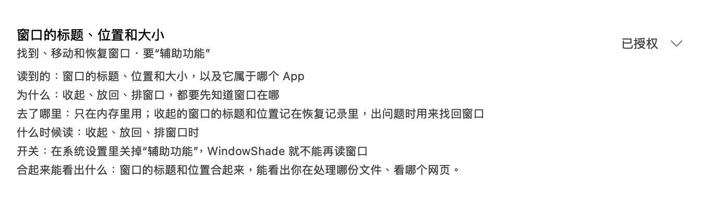
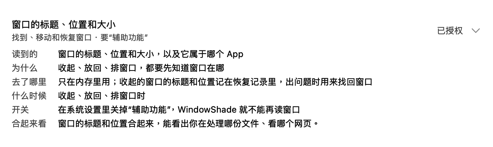
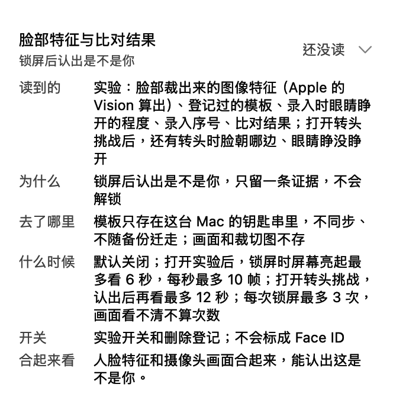

隐私展开已从整段灰句改成标签/正文两列：系统正文减一档默认12、4.4em标签列、10列距/4行距；左侧次要色，正文正常色。短可见标签有完整提示，登记原文和技术接口、只读可选字保持。每个详情子行绑定实际详情宽度，正文扣标签列与间距。

沿已核23候选最小接入，生产只detailLine与详情子行宽绑定；来源/开关/授权/导出/读取周期不改。保24前真实源/QA入口/消费者字节SHA，22原图作当前旧源参考；独立候选不是产品通过证据。

实际PrivacyRowView用合成presentation/注册Data，14669 Swift6原生0/48/current518，新的实际输出消费者0。检查真实body/label roles、字号相对行头、两列/纵向矩形、文字完整cell所需高度、原文/接口、提示/readonly/selectable/颜色层级与长值middle保82%。主模型查看light640展开/dark448技术/light300长计划说明/窄列长值。没有隐藏的整页或来源构造，所有授权目标空。

当前完整优化36743退出0/519，构建过程输入SHA无漂移，原并发/警告视错/优化门禁参数保留；日志仍有既有编译诊断，不称无警告。主模型接手生产实现与消费者，23工人无产物不重派。

通过仅静态真实Row组合、当前字号/当前外观：不是PrivacyPane整页、真实读取/开关/授权/导出/键盘/VoiceOver/动态大字/辅助颜色/性能/联网/磁盘/可见合成/硬件或签名生命周期验收。实验行只是fixture，资格化状态不晋级；整体设计goal active，下一步完整现有组件组合小样，不碰实际系统读取。
