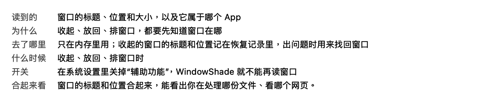
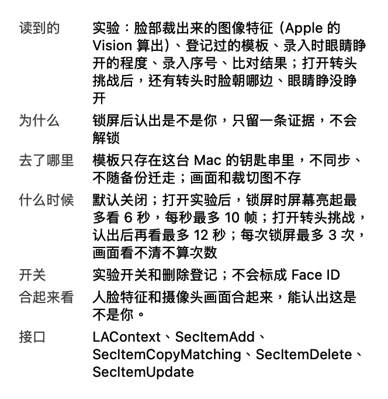

隐私展开两列候选按原稿恢复4.4em标签列、12号正文、10列距/4行距与两层文字颜色。可见标签缩为“什么时候”“合起来看”，完整意思在提示；静态登记表说明逐字保留，技术接口从实际sites按signal去重排序。

生产未改，独立私有AppKit候选36帧，Swift6严格/警告视错Cocoa-only编译0，实际26229native0/consumer0；只有entry+静态registry两份输入，不能冒充生产518库。消费者核对真实原文、sites汇总、完整提示、字体/行列矩形、第一行对齐与纵向间距、浅深实际颜色层级。主模型看普通/深色technical/300长说明。519生产优化输入与22逐项一致复用39527退出0。

首候选63243实际36/native0，长标签留下孤字；缩短可见标签后仍留完整提示。main首编译误用NSColor.resolvedColor退出1，已保源码/log并改原生performAsCurrentDrawingAppearance；不归工人。main首消费者错误要求不可选字，实际wrappingLabel沿既有只读可选，保错误脚本/log后改仅要求noteditable，不制造不必要的行为改动；未执行选择/复制。

DeepSeek任务a79bf3c26dee47f38492430403e55ef5在资料读取时context预算失败，无改动/无检查，实际贡献没有可验收代码；main核对不存在新entry后直接接手实现/消费者/实际图，不重派相同任务。余额提示已去重，未擅自充值。

仅候选：没有PrivacyPane/owner/实际来源/权限/偏好/动作/输入；planned人脸行仅长说明样件，不表示生产默认页出现或事实已资格化。读屏、真实Page交互、颜色辅助模式、动态字号、网络/磁盘隐私、性能/可见合成/硬件未验。下一批按已看清的小样接回真实Row，完整设计目标active。
