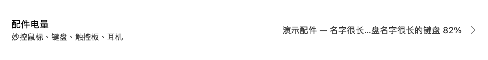
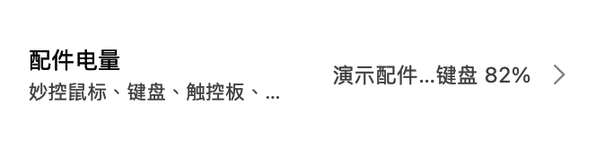
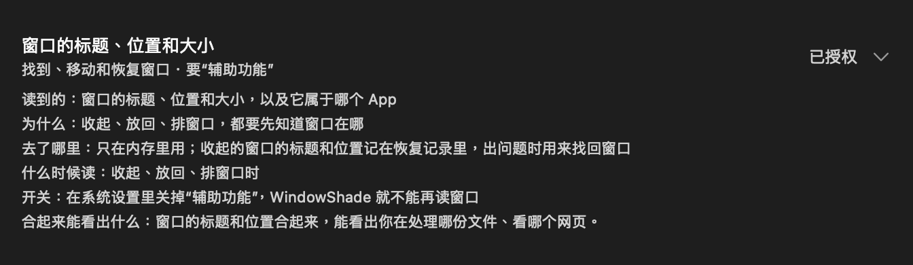

隐私行的名称、原因与当前值现在各守自己的列，长值中间省略，尾部数字保留，完整内容仍在提示。原字号、登记表、来源、开关、授权与导出行为不改。纯视图Row及其SwitchSpec从private改internal供同模块QA直接构造，不新增生产数据入口。

主模型用登记表与合成值直接构造真实PrivacyRowView，没有实例化会读系统的PrivacyPane或owner，所有授权/导出/设置目标为空。普通、未读、拒绝、已授权、长值、展开、技术、计划样件×640/448/300×浅深，共48实际Swift6静帧，62151 native0，实际消费者0/518；主模型查看长值各宽度、深色展开/技术、窄列长实验说明。缓存图不是整页可见/动势验收，实验行样件不是默认页可见证明。

基线30646 native0/32，消费者1：448压力值字段x162+766超出预定预算。基线宿主没有固定宽度，曾随内容扩张；最终夹具固定宽度并记录实际Row/Host，所以不把截图总宽前后差异单独归给生产修正，也不冒充真实设置窗口复现。基线深色背景是夹具提前解析CGColor错误，最终改为原生draw时按实际外观绘制；不归产品缺陷。

中间54275 native0/48/几何消费者0，但真实PNG尾部省略丢82%，主模型拒收，保全原图/源/入口。改value字段middle并记录实际AppKit breakMode5，最终PNG确有82%。17590旧优化检查因视觉新问题作废：确认自己的编译进程链后SIGTERM，实际退出1，保取消原因/input/log，不当编译失败诊断或通过。新的当前优化39527退出0/519，输入逐项SHA仍匹配，完整参数保留。

消费者只检查真实输出的列预算、间距、纵向完整性、提示、字号/换行、middle属性、计划/未知等显示与518来源SHA；不把这些当网络/磁盘隐私保证。早期消费者脚本在加middle与纵向检查前未另存版本，旧日志只保当时实际结果，不当可复跑最终消费者；最终脚本与实际最终输出严格绑定。未跑含独立持久suite的旧纯测试，本轮禁止偏好写。整页顶栏、卡片、滚动、读取时机、授权/开关/导出、读屏、性能、网络/磁盘/硬件均not_run。

原稿展开是4.4em标签列+正文、12号阅读字；当前实现仍连成11号灰句，下一批先做对稿两列小样，不因本轮列布局通过就宣布隐私表面完成。完整设计目标active，未签名、安装、发布。
