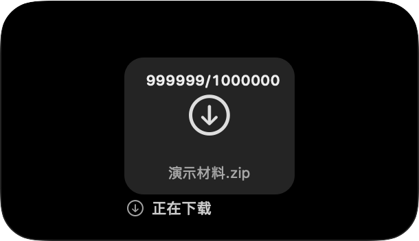

已补[进度静态稿](../../design-drafts/进度.md)，并修正大项数截掉总数的问题。原“第 999999 / 1000000”自然字宽116.32点，在104点内被截成“第 999999 / 1000…”。放不下时沿已有shortCountText，修后“999999/1000000”宽97.88点，保持10.5点字号与卡片尺寸，提示/读屏仍用完整说法。普通项数、百分比、环和未知状态不变。

真实Canvas/Core投影/Tile/ProgressPartLayers的26静帧、30格，涵盖0/42/100%、2/9、999/1000、999999/1000000、不确定、unknown、暂停、结束、过期、长文件名、三条共存，浅深父外观一致黑底。读取实际层隐藏/strokeEnd、AX value/完整tooltip与真实AppKit字宽；最终消费者0、518当前输入，完整优化11812退出0、519输入无变化。本工具链并发warning仍在日志，不称无警告。

DeepSeek写独立标准库消费者，只跑syntax0。主模型纠正浅父误判、三条中的不确定量、隐藏未挂载part的负坐标、part相对tile包含与ring预算，再补实际strokeEnd/0点不留圆头/精确短写判据。主模型自己的广替换也曾引入get多参数错误，原件与失败日志保留，修后实际消费者通过。worker语法与自报不能代替验收。

原始paused/ended夹具沿用“正在下载”标题，最终把明确给定的候选事实写到标题；这是自造状态，不代表任何实际来源已支持暂停或完成。100%未结束样件与明确ended样件分开，现有DownloadCard.finished另用“下载好了”、对勾和unknown，不把这里最后读数的值当该提醒实测。总数0不合现有count有效域，故未给它假样件。

生产只多一个全写/短写字号测量入口与绘制时调用，没有改Core事实、动作、来源、timer或仲裁。主模型看大项数/100%/不确定/暂停实际PNG；cache只证明静态，真实来源、紧凑新样件、旋转、增强对比/读屏执行、完整文件名读屏、极端Int及暂停+大项数仍待，不晋级planned来源。自有alpha0隐藏离屏、无产品入口/Controller/权限/实际资料/全局输入，未提交/签名/安装/发布。整目标active。
