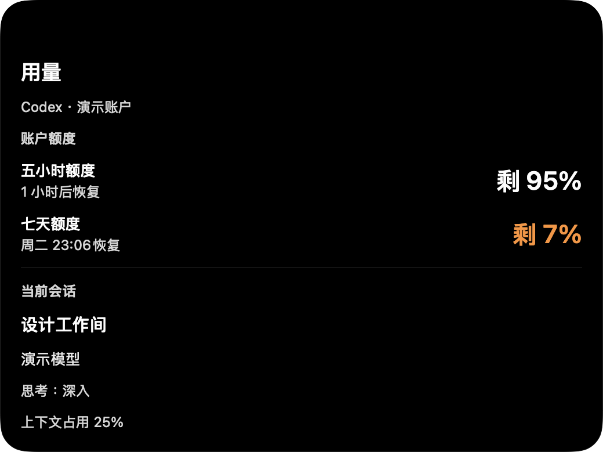
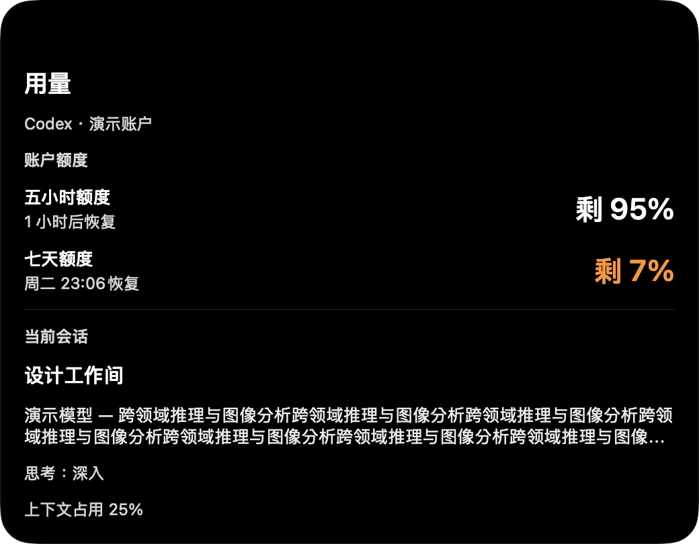

用量详情候选把账户多窗口与当前会话分区，七天窗口不称本周，上下文明确占用。16张自有隐藏原生AppKit画面；实际Core只解析合成账户数据，上下文来源未资格化，无生产接线或真实动作。

基线12419退出0但候选两行文字默默裁尾；独立原生TextKit探针验证末行省略，最终50127退出0，实际消费者0/16/518。消费者读取真实字段、TextKit截断范围、矩形、来源身份和未知/到期/共享口径；主模型查看普通、长模型、过期、遮隐PNG。画面与几何通过范围有限，缓存不是可见合成验收。

生产没有新增修改，第二十批优化19124/519当前SHA逐项一致，复用其退出0，未重复编译。Native请求Swift6/完整并发/警告视错，日志仍可含工具链警告，不称无警告。第一次直接执行wrapper权限126未编译，随后明确bash运行；独立探针无生产代码。

窗口浏览第十四批实图确有末行省略，其cell.truncatesLastVisibleLine已设，初疑点已排除。候选TextKit只在QA，不扩展产品改动。真实返回/Esc/账户选择/刷新/来源/读屏/动势/硬件均未验，整体设计目标active。
