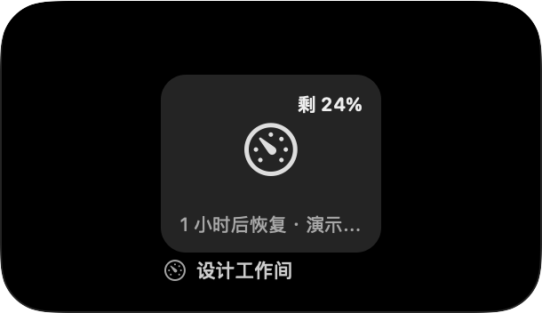
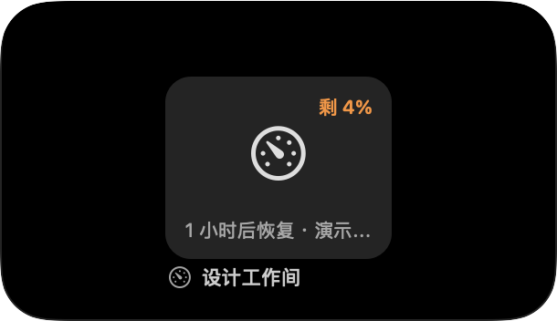
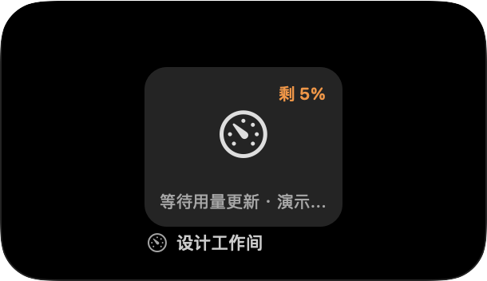
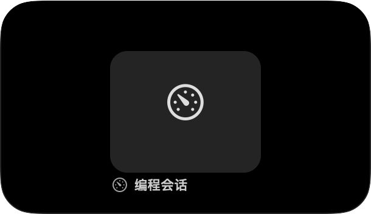

已补[用量静态稿](../../design-drafts/用量.md)，修正额度事实到画面之间的三处断点：普通/低额格子漏剩余数字；同一低额相位数字变化会被数量相同的守卫跳过；旧恢复时刻已到却写“马上恢复”。现在普通写“剩24%”，低额以原琥珀写“剩5%”，同一格原地变“剩4%”；到恢复时刻只“等待用量更新”，真实剩余不被本机时间充满。未知回到在跑，等你优先。

实际纯Core解析→CodingSessionActivities→NotchRow→生产Canvas/Tile，共20当前静帧，剩余/未知/时刻/周窗口/长模型/等你/遮隐，低额更新保同签名同Tile身份。实际消费者0、518输入当前；49用量断言、851共同一排断言与完整优化19124退出0、519输入相同。parse拒绝超出Int可表示范围的恢复时间，保额度，防窗口身份转换崩溃。只控制自己合成的WireJSON与自己隐藏离屏alpha0宿主，无账户/网络/模型任务或产品Runtime/Controller。

首次95727旧16帧与纯49505测试133证明漏数/虚假恢复；第一次修正普通成功但quotaLow仍漏earText，78595原生18帧退出0而实际consumer1，不能算通过。旧unit手写cell漏掉了实际Activity投影，新增真实投影红测42200/851一失败，再修核心投影，最终56763/851零失败；partial-build的2464完整编译0也不冒充最终视觉通过。原始与半修产物保留。主模型直接设计、实现与消费者，没有本批DeepSeek产物；前两批消费者误判多，避免把syntax自证当验收。

新数字随原sessionRedacted一起隐藏，不写共享系统设置，实际遮隐值的提示/读屏不露量/项目/模型。完整优化和native都保Swift6/严格并发/警告门槛；此工具链仍发warning，日志保留，不称无警告。Core低额原位路由的Panel guard经主模型实际差异复核，样件跑Canvas专用入口，不声称实际Panel生命周期或真实通知通过。

稿只覆盖已有会话格，账户多窗口详情、完整模型/上下文分离与紧凑新帧未做。低额提醒仍沿原每窗口规则，真实更新/刷新/提醒/读屏执行、合成动画/硬件/签名生命周期未验。源码与素材自造，不提交/签名/安装/发布；完整目标active，下一批先做账户详情设计小样。
