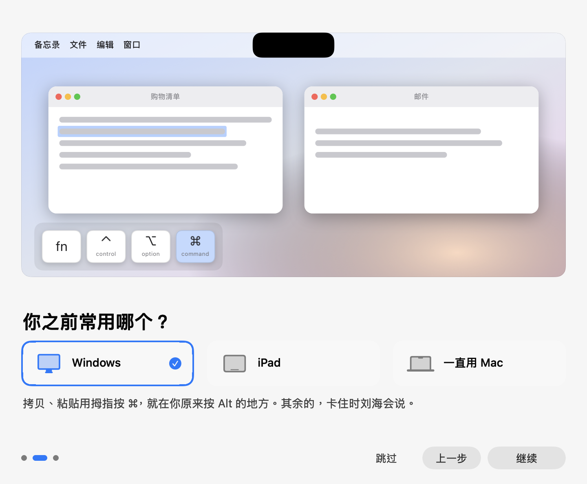
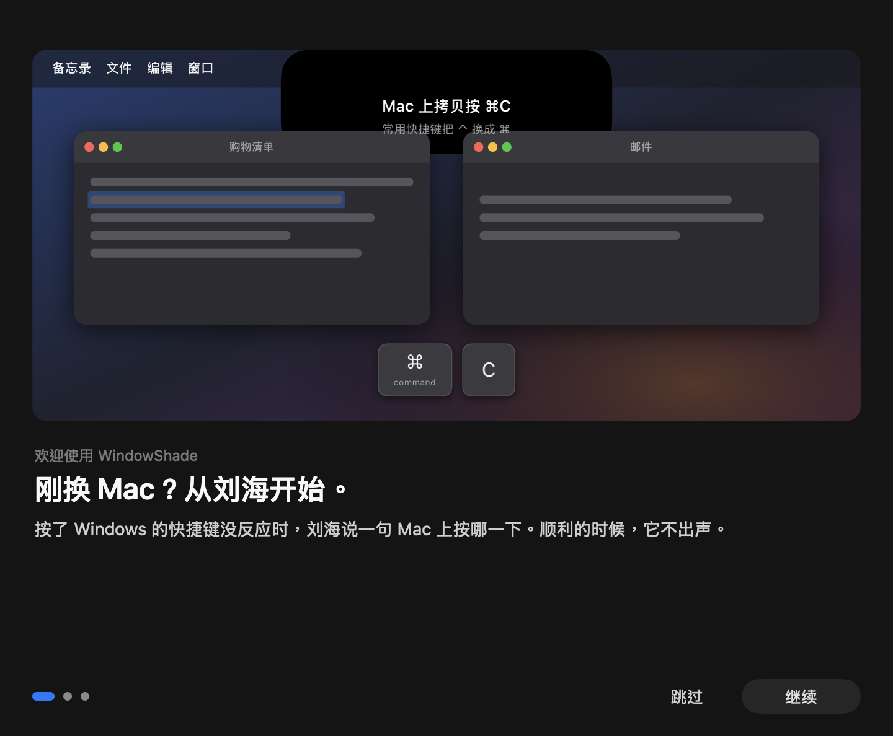

欢迎页前两步的生产结构已有14张静帧：卡住、提示、无刘海、尚未回答，以及 Windows／iPad／Mac 三个选择，分别在浅深系统外观下采样。720×594内容尺寸、标题与说明的实际位置、选择后“继续”可用、尚未回答时禁用，均由独立消费者核对。7对外观图确实不同，欢迎窗口没有被固定成刘海的深色。本批没有产品改动。

这些图片沿现有 WelcomeView／WelcomePreview 和 showWelcome 的 fullSizeContentView、withinWindow 材质宿主生成。没有读取或请求真实权限，没有运行安装／更新步骤；14个状态的权限 closure 调用数为0，选择仅由 preview 指定，存储中的来处保持不变。窗口隐藏、透明、离屏，应用不活跃，结束移除自造窗口。它们证明当前静态内容几何和状态，不能证明真实点击、焦点、读屏、授权与动画。

首次入口被安全检查拒绝：NSWindow 初始化把 -8000 的内容位置挪回了 960／320。最小探针确认窗口仍隐藏且应用不活跃，显式设置窗口 frame 后才保持离屏。第二批入口漏了生产材质宿主，透明底上的文字在预览中看似消失；那批图片保留为 incomplete-host，不拿它指控产品。第三批挂齐实际宿主，标题、说明和导航恢复可见。

教学开口的副句在缓存图中仍被窗口盖住，但源码已把提示设为 zPosition 7、刘海设为6，窗口为0。独立40×40像素探针中，先加入的红色 z7 被后加入的蓝色 z0 盖住；cacheDisplay 和 layer.render 都输出蓝色，证实当前截图路径没有按 zPosition 合成。因此层叠的真机视觉结果为 inconclusive，本批不为修截图而改产品图层，也不宣称副句在屏幕上确实被挡。系统材质和默认按钮的真实焦点状态、减少动态效果与翻页仍待可见界面验收。Apple 对 [render(in:)](https://developer.apple.com/documentation/quartzcore/calayer/render(in:)) 也明确区分模型树绘制与动画渲染树，并说明部分合成属性的限制；本机 z 结论来自实际探针，不归给文档。

对应稿有一项需要对账：[旧欢迎稿](../../design-drafts/欢迎使用%20WindowShade.html) 是七页功能教学，现代码明确依照 [动效样片 M4](../../design-drafts/安静的刘海%20动效样片.html) 的“三步一口气”：刚换 Mac、来处、授权。M4的标题和首句与代码一致。本批沿当前明确的三步方向采样，不凭旧稿倒退成七页；差异已记入 design-grammar。

当前产品来源没有改变，第九完整优化构建的519项 SHA 均仍匹配，复用其退出0，不重复全量编译。此次原生来源518项与最终消费者均通过。主模型完成样件、实际观察和独立诊断；没有委派或把截图限制当作全设计验收。原七线、授权页和设置、窗口、共同五态、多屏与动效目标仍在推进。
