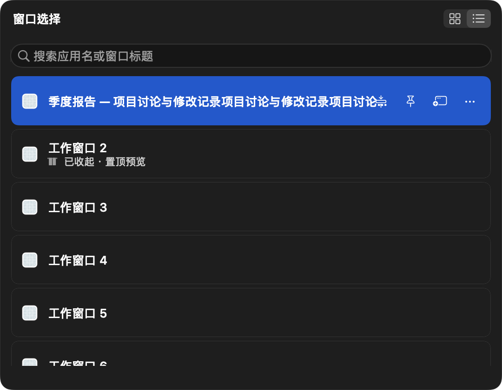
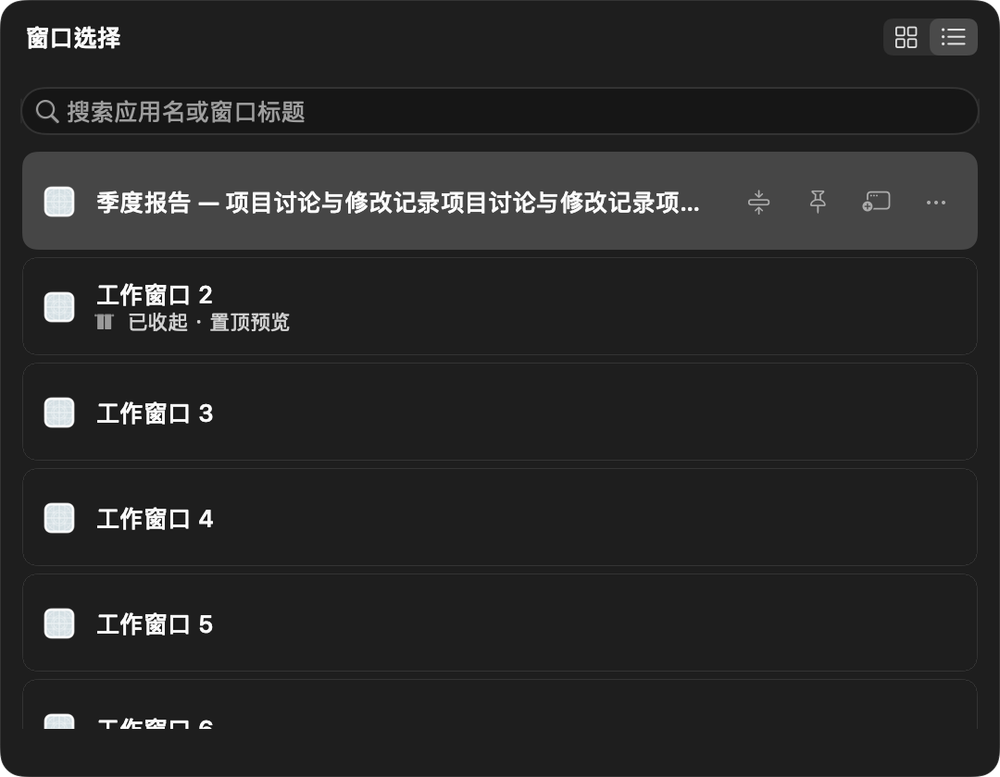
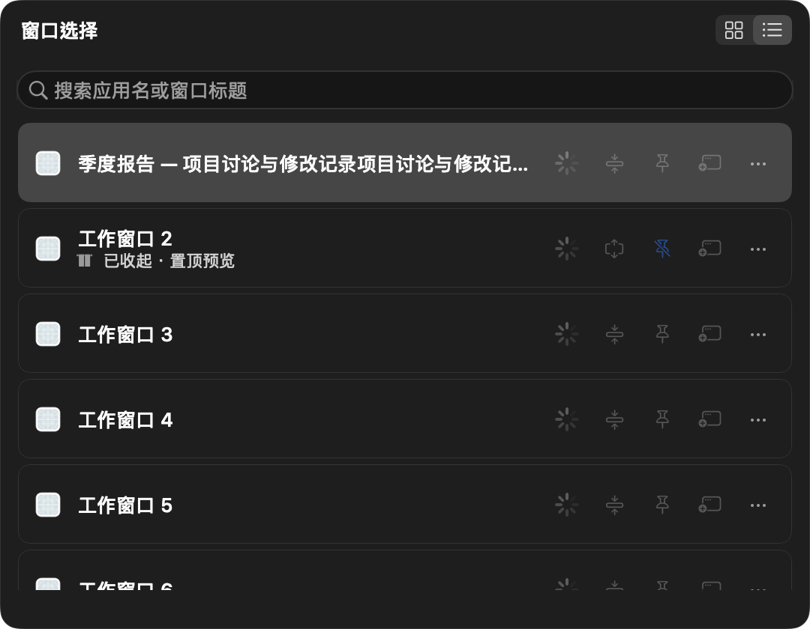
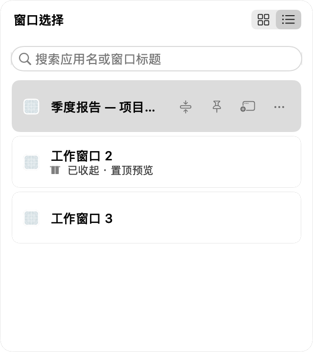

窗口浏览列表的长标题不再压住右侧按钮。原行只预留92点，实际含“更多”的操作条需124点：516点行里，标题到408、操作条从384开始，重叠24点。现在按实际requiredWidth与原92点取较大值，标题与状态都在操作条前留8点；隐藏时仍预留，不让悬停改变标题位置。

修后同一行标题到376、操作条从384开始；忙碌指示时操作条156点，标题到344、操作区从352开始；320点窄列表中标题到156、操作区从164开始。完整标题仍在真实tooltip里，按钮数量、动作、能力准入和数据状态不改。

实际生产WindowBrowserContentView与materialHost覆盖空、无匹配、单窗口、六窗口网格、长列表、忙碌列表、窄列表、忙碌未知网格、无权限九种状态，paper/system两种诊断材质、浅深外观共36帧。系统玻璃内容挂在真实contentHost中，面板圆角13；缓存图不代表真实玻璃合成、焦点或动画品质。系统默认应用图标仅用于合成不存在PID，无用户App图标；没有输入缩略图或实时画面，本批不验真实预览。

初始28帧生产几何检查0却漏掉文字和操作条的重叠，实际PNG被主模型拒收。补实际row/title/actionBar测量后红例1，原消费者/源/日志保留。生产修后36帧消费者0。又发现样件先update后挂窗口使选中行把nil window当可强调状态，蓝色不代表实际未激活宿主；修QA为生产先挂宿主再update后，最终36帧和消费者0，未为颜色改产品。前两批只作为对应几何/失败证据，当前验收图使用after。修前蓝色与修后灰色的差异来自样件顺序，不是本次生产颜色改动。

独立消费者读取真实可见文本、全标题tooltip、行标题/状态与实际操作条矩形、requiredWidth、viewport、材质挂载与518项来源SHA；不只检查控件在卡片内。主模型看过修前长列表/网格/空状态、修后长列表/忙碌/窄列表/无权限实际PNG。窗口透明、离屏、不激活；仅值类型记录与自身窗口，不构造控制器或真实Panel/阴影子窗口，不调用AX/窗口动作/权限申请/截图服务，也不写设置。

完整优化`prototype/build.sh --check`于UTC 2026-10-11T10:33:53.283222退出0，519构建来源与最终518原生来源均当前；Swift6/完整并发/警告视为错误参数与门禁保留。离屏原生工具采用独立Swift5入口，不冒充签名Swift6执行期。未签名、安装或发布。

本次主模型直接修一个布局表达式，未另派工人；已有原生宿主实践补入“数据更新沿生产挂载顺序”，保底原字节与SHA、实践激活输出保留。全蓝图设计目标仍active，真实窗口切换、权限/图像/拖放/焦点/键盘/动画仍待。另一个待修问题：网格标题虽有两行高度，当前tail模式禁用了wrap；独立最小AppKit字体探针已复现，后续单独修和验，不算本批已完成。
