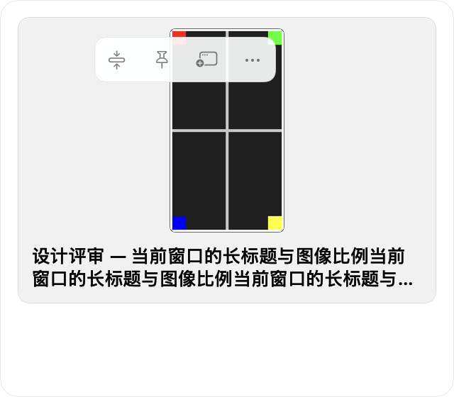
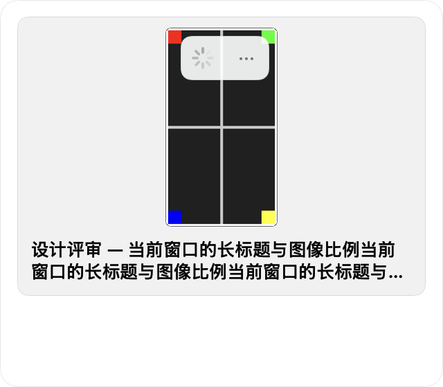

窄竖图的操作条现在完整落在画面内。原画面宽81点，操作条128点，左侧悬出53点；按实际画面宽度保留首个操作和“更多”后，操作条64点。其余动作仍走原完整菜单，卡片原辅助操作也保留；忙碌时保留转圈提示和“更多”。横图保留完整操作条，按钮命中区仍是28×28，列表行默认不做这项折叠。

图像来自自造诊断PNG，覆盖16:9、4:3、方形、9:16、3:1。实际ImageIO解码→WindowBrowserContentView.applyThumbnail→Card/NSImageView布局，实际纯derivedParams，先挂宿主再update。浅深父外观×paper/system×五比例×普通/悬停×普通/忙碌共80帧，再用同一卡片竖→横→竖两帧验证按钮64→128→64恢复，最终82帧。独立消费者核对实际图像比例、card/picture/title/bar/按钮矩形、28点命中区、更多/忙碌、完整标题提示和当前518来源；原生图由主模型复核。静态system材质只验宿主与几何，不冒充实时玻璃合成。

按实际Dock规则不画键盘选中环。第一版误以为传selection就会出现操作条，40帧实际全不选中，原错误预期保留；不是生产缺陷。最终悬停只直接调用自己的card.mouseEntered接收方法，不post到NSApp或系统，不移动鼠标，不激活/显示窗口。onHoverChanged只计本地次数，真实窗口动作和全局输入事件都是0。

DeepSeek承担标准库图案生成器和五图清单；worker三个同revision检查退出0不能当图像语义验收。主模型独立PNG/CRC/像素检查发现中央十字覆盖每张图288个白边像素，原件保留，修正生成器两行范围后白边/四色/中心/透明度检查通过。之后原生40帧粗消费者只约束操作条位于card内，主模型从实际PNG发现窄图悬出，补picture包含判据红测再修产品，原粗通过不冒充窄图视觉通过。

生产只改Card的可用宽度安排和ActionBar的尾部按钮显示/宽度缓存；configure/reset/浮层与更多策略变化都会失效缓存，避免每次布局来回切隐藏。原contextMenu及事件处理路径保持原样，没有增加观察者或定时器。第一版80帧修正产物另放after-fit，带缓存与同卡复用的最终产物在cached-fit。

源/证据身份及完整优化回执见validation.json/build-exit.json。仅自造像素、假PID、值记录、自有alpha0隐藏离屏窗口；不构造Controller/Panel/截图服务/权限或真实来源，不读取用户窗口、文件或账号，不写设置，不提交/签名/安装/发布。真实内容、动态合成、菜单执行/焦点/读屏/系统指针/硬件尚未验，整体目标继续。
